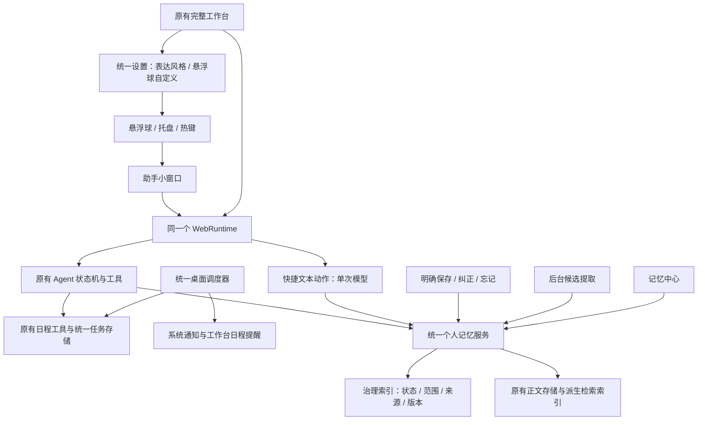

# NovaMind Personal Agent 产品与实施任务书

版本：1.3（明确完整 Agent 与悬浮球的通用图片输入和识图能力）  
编写日期：2026-10-20  
适用工作区：`D:\claudecode\NovaMind`  
优先平台：Windows，单用户、本地桌面使用  
用途：交给开发 Agent 执行的需求与验收基线。

> 本文描述目标和待执行工作，不是完成报告。现状依据本次源码静态检查；未重新运行测试、调用真实模型或操作桌面。原有验收报告中的测试数、覆盖率和打包数据属于历史报告，不视为本次复核结果。

## 1. 最终要做成什么

NovaMind 是专门服务于我的 Personal Agent。它了解我的表达偏好、学习方式、工作习惯和长期项目，能帮助我研究、学习、设计、编程、写作及处理日常事务。

我希望在使用其他软件时，也能通过悬浮球或快捷键随时打开它：小事在小窗口完成，复杂任务交给现有完整工作台，前后保持同一件事的上下文。随着使用积累，NovaMind 应逐渐减少我重复交代背景的次数，并能接受纠正和忘记要求。

通过对话，我还可以直接把事情记进 NovaMind 的日程安排，到约定时间得到提醒。默认回答延续 NovaMind 原来的自然、简练、熟悉用户的表达方式，同时允许我调整说话风格。悬浮球与完整工作台属于同一个应用：双击一个打包程序即可一起启动，并在工作台中自定义悬浮球。

原有深度研究内核是它的优势之一，研究、技能、工具、沙箱、文件操作、审计、诊断、会话管理等能力继续沿用。产品方向从“以研究为中心的工作台”扩展为“以我的日常使用为中心的个人助手”。

### 1.1 用户应感受到的四件事

1. **随时可用**：点击悬浮球或按快捷键，就能开始输入，不需要先进入完整工作台找入口。
2. **事情能接着做**：刚才翻译、解释或讨论过的内容，在小窗口追问、打开大窗口、重启后继续时能衔接。
3. **越来越了解我**：明确说过的偏好和项目背景，在相关任务中能自然应用，无需反复说明。
4. **我说了算**：我能看到、修改、暂停和删除记忆；纠正优先于旧印象，忘记后不能继续从别的记忆入口注入。

“类 Codex 的记忆体验”在本文中指以上可观察体验，不要求复制任何其他产品的内部架构或未公开机制。

### 1.2 本轮的交付范围

本任务书要求完成以下闭环，不能只交付底层 API 或技术验证：

- Windows 常驻入口：托盘、悬浮球、快捷键、个人设置。
- 可输入任意任务、继续追问的个人助手小窗口。
- 翻译、解释、总结的轻量路径；移除独立“改写”功能入口，替换为“记录”入口，用于通过对话写入日程并定时提醒。
- 完整 Agent 对话框支持上传、粘贴和拖入图片，悬浮球打开的助手小窗口具备同等图片输入与识别能力；支持看图描述、解释、分析和连续追问，翻译只是可选用途之一。
- 小窗口与完整 Agent 的会话衔接。
- 明确记住、候选审核、跨会话召回、纠正、暂停、忘记。
- 记忆中心与清楚的记录/使用开关。
- 日程记录、查看、调整、取消和到点提醒；沿用现有日程工具与存储。
- 保持原有默认回答风格，并提供可自行调节的表达风格设置。
- 完整工作台内提供悬浮球自定义；一个打包程序统一启动和管理工作台、球、托盘与提醒。
- 原有工作台功能的相关回归。

原任务书第 10 节只要求先交付 A0/B0，与前文完整路线图存在执行范围上的区别。本版本明确：技术验证已存在，应在当前实现上补齐个人产品闭环；实施过程中分阶段交付，不能把第一个阶段完成写成整体完成。

### 1.3 本轮不扩展的方向

- 不建设多用户账号、云端记忆同步、团队管理或企业级平台。
- 不默认持续监控屏幕、剪贴板和键盘，不自动搜集我的所有活动。
- 不增加自主点按、自动发送消息等新的桌面执行权限。
- 不推倒 Agent 内核，不另起一套与现有记忆割裂的数据库或 Agent。
- 不为了本次迭代增加复杂多 Agent 编排、全平台适配或大规模压力测试。

## 2. 当前实现的真实基线

以下“已存在”仅表示源码中有实现，不代表已经完成真实桌面和真实模型验收。开工时须保留当前工作区的既有修改，包括未跟踪文件，不可通过 reset、覆盖或删除获得干净状态。

| 能力 | 当前代码情况 | 本轮处理 |
|---|---|---|
| Agent 内核与完整工作台 | 现有状态机、工具、会话、技能和审计继续存在 | 复用并做相关回归 |
| 桌面外壳 | `novamind/desktop/shell.py`、`win32_shell.py` 已有托盘、球形窗口和快捷键 | 修正日常使用中的入口、设置和生命周期问题 |
| 单实例 | 互斥量与 `/shell/wake` 已有代码 | 核对所有产品入口，重复启动要唤醒已有实例 |
| 快捷操作 | `quick_actions.py`、`quick.html/js` 原有翻译/解释/总结/改写与 SSE | 目标改为翻译/解释/总结 + 记录；记录走真实日程写入，不能机械套单次文本模型 |
| 通用小窗口对话 | 当前面板主要是文本转换动作，无完整的持续对话状态 | 新增通用助手体验及对话式日程记录，复用原 `/chat` |
| 原有日程 | `core/tools/builtins.py` 已有 `schedule_task`、`list_scheduled_tasks`、`modify_scheduled_task`、`delete_scheduled_task`，`task_store.py` 管理 `tasks.json` | 复用并补桌面接线、结构化反馈、状态与通知投递 |
| 定时检查 | `core/heartbeat.py` 已有 `pacemaker_loop`，目前在 `entry/main.py` 的 CLI 主循环启动 | 接入统一桌面生命周期，到期后直接可靠展示提醒，不能只写入 CLI 消息队列 |
| 打包启动 | `packaging/gui_entry.py` 当前按 `--desktop`/环境变量分流桌面外壳或完整 GUI | 改为默认同一应用统一启动，保留必要兼容入口，不要求用户分别启动 |
| Quick → 工作台 | 当前前端只传输入文本，后端保存一条 HumanMessage | 不能当作完整问答续接，需要传递会话和已完成结果 |
| 记忆治理 | 已有 proposed/active/rejected/disabled/deleted、revision、tombstone | 保留，补齐所有写入和召回入口的一致性 |
| 记忆中心 | 已有列表、详情、确认、编辑、禁用、删除 UI/API | 补齐可用性、明确记住、分页和生效反馈 |
| 旧画像 | `save_user_profile` 仍覆写画像文件，`ContextManager` 仍直接注入整篇画像 | 优先收敛，避免绕过新记忆治理 |
| 记忆设置 | `/settings/memory` 当前替换进程内配置 | 补持久化和所有调用路径的一致生效 |
| 个性化评测 | 现有确定性样本主要检查检索结果与治理状态 | 与真实回答遵循偏好、真实并发、桌面验收分开报告 |

### 2.1 已确认、必须处理的具体缺口

1. **画像仍有两条真相源。** `novamind/core/context.py` 的 `load_user_profile()` / `build_system_prompt()` 仍读取画像文件；`core/tools/builtins.py` 的 `save_user_profile()` 既写文件又桥接 procedural 记忆。记忆中心删掉某条记忆，不能据此保证旧画像不再注入。
2. **全局关闭记忆没有覆盖所有路径。** `/quick/actions` 的 `_quick_preferences()` 未检查召回开关；旧画像读取也不受新召回过滤控制。设置目前只在进程内替换，缺少重启恢复。
3. **任务范围没有真正接入运行时。** `filter_recallable()` 只有收到 scope 才限制范围，而默认召回中间件没有从当前会话/项目解析 scope。不能把底层支持 scope 写成已经实现项目隔离。
4. **快捷操作的容量控制未与 Agent 合并。** `server.py` 每个 Quick 请求新建 `QuickActionService`，因此它自己的 semaphore 不能限制多个 HTTP 请求的总量；该路由也未沿用 `/chat` 的 Runtime 容量与任务登记流程。
5. **小窗口上下文衔接不足。** `quick.js` 没有持续会话状态，升级只提交 `{text}`，不带动作和回答。不能保证“继续刚才的分析”。
6. **选区导入只在页面初始化时拉取。** `prefillSelection()` 绑定页面加载/`pywebviewready`；复用已存在窗口时，`show_panel()` 没有明确通知页面导入本次选区。需要按每次主动唤起处理。
7. **桌面设置不完整。** `DesktopSettings` 只有球的位置、显示和最近会话等字段；托盘菜单缺少隐藏/恢复球及设置；没有可配置热键与冲突处理。定位只使用 `screens[0]`，尚不是多显示器定位逻辑。
8. **“不复活”和“已确认优先”的实现边界不足。** tombstone 按内容寻址 ID 判定，不能阻止旧历史被重新表述成新 ID；编辑后旧内容也未建立完整的来源版本屏障。worker 先 encode、再登记 proposed，加上“无治理记录视为 legacy active”，存在中间状态和失败后绕过审核的风险。
9. **记忆合并会提前让旧记忆失效。** `_maybe_consolidate()` 未先筛选可合并治理状态；manager 合并会标记旧正文 forgotten，`note_consolidated()` 又把旧 active 置 disabled，而新结果仍是 proposed。需要避免自动合并导致已确认知识暂时不可用。
10. **记忆中心筛选和规模处理不足。** `loadMemories()` 先覆盖面板再读取筛选值，筛选控件已被移除；页面请求固定前 200 条，没有完整的继续加载。此类用户操作问题应随记忆中心一起修复。
11. **已有日程工具不等于桌面提醒闭环。** 当前桌面 Runtime/Shell 中未见 `pacemaker_loop` 的完整启动与通知展示接线；现有心跳将到期项交给 Agent，不是独立可靠的桌面提醒。需要补上常驻调度、投递状态和离线恢复。

以上是源码推导的问题和风险，未在本次静态检查中实际运行复现；开发时应以最小复现确认并修复，不能仅修改报告措辞。

## 3. 产品交互要求

### 3.1 悬浮入口与托盘

悬浮球、展开菜单和助手小窗口必须遵守第 3.4 节的设计规格。本轮需要重做当前字母渐变球及其独立深色菜单，使其与完整 GUI 成为同一套产品界面；不能只调整几处颜色后交付。

- 球可拖动、隐藏、恢复，位置和显示偏好在重启后保持。
- 拖动和点击能区分，不要拖完意外打开菜单；提供贴边吸附，避免吸附过程抢走输入焦点。
- 点击后优先提供清楚的“问 NovaMind”入口；翻译等动作作为快捷入口，不让整个产品看起来只做划词翻译。
- 球在隐藏状态下，也能通过托盘和快捷键恢复。托盘至少提供：打开助手、打开工作台、显示/隐藏悬浮球、设置、退出。
- 退出意味着释放热键、托盘、窗口和后端资源；关掉小窗口或工作台只收起窗口，不意外终止常驻。
- 发布一个桌面打包程序；默认双击后同时初始化完整工作台、悬浮球和托盘，首次启动显示工作台并显示悬浮球。之后按保存的显示偏好恢复。不能要求用户另开一个 EXE 或手动带 `--desktop` 才有球。
- 原有 `novamind gui`、`novamind desktop` / `--desktop` 如需兼容保留，应汇入同一实例与同一生命周期，只改变初始窗口显示策略；不能各自启动一套后端。详见第 3.9 节。
- 开机启动可以先提供说明或简单设置，默认关闭，不因此阻塞本轮主体交付。

### 3.2 助手小窗口

默认支持直接输入任意需求，例如“解释这个概念”“安排今晚的复习”“帮我构思一张海报”“接着看我的项目”。

小窗口包含：输入、最近对话、发送/停止、复制、开始新会话、继续当前会话、打开完整工作台。小窗口可适当调整大小，长回答能滚动；不需要塞进完整技能和审计管理面板。

执行路径清楚可见：

| 路径 | 用途 | 执行方式 |
|---|---|---|
| 助手对话 | 文字或图片提问、连续追问、需要工具的任务 | 复用现有 `/chat`、同一 Runtime 和 Agent；图片走真实多模态消息 |
| 快捷文本动作 | 翻译、解释、总结当前提供的文本 | 单次模型路径，禁用工具，结果可继续讨论 |
| 记录 | 把对话中的安排写入日程，并在指定时间提醒 | 调用原有日程工具/统一日程服务，真正持久化，不能只生成“已记录”的文字 |
| 图片理解 | 上传/粘贴图片后按问题识别、解释、分析；需要时翻译 | 属于正常 Agent 对话能力，不要求切换到专门翻译模式；快捷翻译仍保持禁工具路径，详见第 3.5 节 |

初版不新增 LLM 路由器。通过用户选择的动作/模式确定路径。需要工具的执行继续遵守已有权限和沙箱约束，不因为窗口小而获得额外权限。

“打开工作台”后仍能看见刚才的问题和已完成回答，并可直接追问。再回小窗口时，不另开一个失忆会话。切换显示视图不重新执行已经完成的模型请求。

### 3.3 选中文字

- 手动粘贴始终可用；自动获取只在用户主动触发的选区操作中执行。
- 每次唤起要区分“新选区”“无选区”和“继续旧会话”，不能反复使用过期选区，也不能覆盖正在编辑的草稿。
- 普通“打开助手”不强制模拟复制；“使用选中文字”是明确的动作或可配置热键行为。
- 捕获失败时显示可手动粘贴，不能误把旧剪贴板当作新选区。
- 若临时使用剪贴板，需要避免破坏原有富文本、图片或用户并发复制的内容；无法安全恢复时优先回退手动粘贴。不要只比较文本值就声称剪贴板完全恢复。
- 翻译、解释和总结只生成结果，不自动替换外部软件原文；记录日程只在明确安排意图和必要时间清楚后写入。

### 3.4 悬浮球与小窗口设计规格（必须实施）

#### 3.4.1 视觉方向与当前问题

以当前完整工作台的 GUI 为视觉基准：**冷白浅蓝、深海军蓝文字、精细线性图标、轻边框、柔和圆角与充足留白**；深色模式是同一套设计的深海军蓝版本。

目前 `_BUBBLE_HTML` 使用字母 N、蓝色径向渐变和较重阴影；`bubble_menu.html` 与 `quick.html` 独立硬编码深色配色、按钮和字体层级，没有跟随完整工作台。这三处都需要调整，视觉验收不能只看“透明窗口能显示”。

视觉目标是一个安静、精致、随手可用的个人工具入口。不要做游戏球、发光能量球、卡通吉祥物或另一套品牌。

#### 3.4.2 共享设计变量

优先复用 `novamind/webui/static/workspace.css` 的现有设计变量，而不是手工维护三套接近的颜色。下面是当前基准，不是要求新增品牌色：

| 用途 | 浅色 | 深色 |
|---|---|---|
| 页面底色 `--bg` | `#f8faff` | `#111827` |
| 次级面 `--surface` | `#f2f6fc` | `#131d2e` |
| 卡片面 `--paper` | `#ffffff` | `#182338` |
| 主文字 `--text` | `#14213a` | `#e5edf9` |
| 次文字 `--dim` | `#5f708c` | `#a4b3cc` |
| 边框 `--border` | `#e4ebf5` | `#2a3850` |
| 选中面 `--selection` | `#e5eeff` | `#223a63` |
| 强调色（现名 `--teal`） | `#285bd9` | `#8eb5ff` |

- 字体延续工作台的 Segoe UI / 苹方 / 微软雅黑系统字体链，不为球另加字体依赖。
- 图标沿用工作台同类线性 SVG：通常 16–18px，描边约 1.5–1.75px，统一圆角和端点。不要以“译、释、摘、改”等单字、emoji 或杂乱 Unicode 符号代替图标系统。
- 深浅主题跟随完整工作台设置，首次遵从现有主题默认规则；任意窗口切换主题后，其余已打开窗口能同步。不同 WebView 之间不能仅假定 localStorage 的变更事件一定可用，应做明确同步。
- 可以抽取共享 `theme.css` / 主题模块，再给桌面入口独立布局样式；文件名可调整。不要把工作台的 `body` 网格和侧栏样式整体套到小窗口导致布局污染。

#### 3.4.3 球体本身怎么画

| 元素 | 实施规格 |
|---|---|
| 可见球体 | 默认直径 **48px**；允许设置中提供紧凑 40px / 默认 48px / 大号 56px。这里都是逻辑像素，DPI 放大后仍应清晰 |
| 外形 | 正圆，1px 轻边框；浅色用白色卡片面，深色用深色卡片面。静止时不使用大面积蓝色渐变 |
| 中央标志 | 默认复用现有 `nova-mark.svg` 的品牌形状，约 24px，光学居中；不再使用字母 N。用户明确在工作台选择自定义图标时，按第 3.8 节替换 |
| 深色 Logo | 保留品牌标志的镂空和中心细节；用正确的可换色 SVG 或保留对比的反色处理，禁止用 `brightness(0)` 把细节压成整块白色 |
| 立体感 | 一层细小柔影即可，强度与工作台卡片协调；不加粗大黑影、多重发光圈、明显玻璃高光 |
| 状态标记 | 必要时在右下方显示 5–6px 小点，留 2px 的背景隔离边；空闲不显示无意义红点 |
| 原生承载窗 | 透明、无边框，不出现白色/黑色矩形背景；为细影留合理余量，保证阴影不被裁切 |
| 命中范围 | 可点击区域围绕球体，不因透明大窗口挡住周围应用；必要时对透明余量做本机命中处理。不能只有视觉透明但实际挡住一大块桌面 |

球默认距离所在显示器工作区右边、下边各约 **20px**，避开任务栏。已有合法保存位置优先恢复；保存位置失效则回到可见工作区。不得将坐标一律限制在主屏 `(0,0)` 起点，负坐标副屏同样有效。

#### 3.4.4 点击后显示什么

保留轻量菜单，但必须重新设计信息层级：

1. **单击球**：打开紧凑入口菜单，第一项明确为“问 NovaMind”，不直接强制进入翻译。
2. **选择“问 NovaMind”**：打开通用助手小窗口，输入框可用。
3. **选择翻译/解释/总结**：打开同一个小窗口并选定动作。有已授权的新选区时预填；没有则显示粘贴入口，不自动拿旧剪贴板执行。
4. **选择“记录”**：打开同一个小窗口的日程记录状态，可输入安排并继续补充时间；已有文字只能作为待记录草稿，不能点击菜单后未经解析就直接创建日程。
5. **右击球**：显示显示/隐藏、设置、退出等辅助菜单；设置打开完整工作台的悬浮球设置页，不另开独立设置程序。
6. **默认全局热键**：直接打开助手输入。选区处理可设置单独动作，避免每次打开助手都模拟复制。
7. **再次点球 / 点击外部 / Esc**：收起入口菜单；不清掉草稿、不取消已有任务。停止任务使用明确的停止按钮。

入口菜单参考结构：

```text
┌────────────────────────────┐
│ [品牌标志] NovaMind     [×] │
│                            │
│ [聊天图标] 问 NovaMind    ↗ │
│                            │
│ [翻译] 翻译   [解释] 解释  │
│ [摘要] 总结   [日程] 记录  │
│ ────────────────────────── │
│ [窗口图标] 打开完整工作台  │
└────────────────────────────┘
```

线框中的方括号表示真实 SVG 图标，不是要将这些文字原样画成按钮。对话框中的添加图片按钮须接入第 3.5 节的真实附件流程；不要新增无实际功能的语音、模型选择或分享按钮。

**菜单尺寸与排版**：宽约 244px，高度随真实内容自然撑开，不使用过小的原生固定高度裁切底部；卡片圆角 16px、内部留白 12px。主入口高约 40px，使用浅蓝选中面；四个动作两列排列、单项高约 36px；底部工作台入口为次级行。普通文字 12–13px，辅助文字 10–11px。

**菜单位置**：优先在球朝屏幕内部的一侧打开，距离球 10–12px；空间不够时翻转方向并限制在球所在显示器工作区。球在副屏上时，菜单也留在副屏；不能突然跳回主屏。定位使用真实内容尺寸和缩放信息。

#### 3.4.5 助手小窗口怎么设计

- 默认约 **420px 宽、520px 高**，最小可用尺寸约 360 × 360px；用户可调整，尺寸不超过当前工作区。窗口位置与球关联，之后尊重用户拖动位置。
- 外层为与工作台一致的卡片面、1px 边框、16–18px 圆角与柔影。文字区清晰，不靠大面积半透明模糊表现高级感。
- 顶栏约 44px：品牌标志、NovaMind、当前会话的简短标题；右侧放“在工作台打开”和“收起”图标，提供工具提示。状态文字不能盖住标题。
- 中部以对话为主体，用户消息与 Agent 消息沿用工作台的视觉语言；空白时显示一句“有什么想一起完成的？”和少量任务建议，不放巨大的装饰图。
- 底部输入区沿用工作台圆角输入框和深色圆形发送按钮。停止、发送、生成状态保持可见，长文本不把操作区挤出窗口。
- 输入区支持直接粘贴图片；待发送缩略图放在输入框内部的附件行，不另开上传页面，不遮挡发送/停止。小窗口附件较多时横向滚动或折叠，不能撑破窗口。
- 快捷动作使用小型标签/菜单切换，当前模式清晰可见；选择翻译时才显示目标语言，选择记录时显示待解析/已保存的日程信息。说话风格的完整调整放在工作台设置中，小窗口最多保留轻量入口。
- 记忆状态只用一行简洁提示或小图标，例如“个人记忆已开启”“本次不记录”，可点击调整；不在主界面堆砌 Runtime、ReAct、SSE 等实现名词。
- 原文和回答可收纳，但用户仍能查看；同样的按钮、输入框、滚动条、复制反馈在完整工作台和小窗口里保持一致。
- 明亮桌面与深色桌面背景下均要辨认清楚边缘；不允许出现直角底板露出在圆角后方。

#### 3.4.6 动效与真实状态

动效用于表达点击、展开、拖动与执行状态，保持短而连贯：

| 状态/动作 | 视觉与行为 |
|---|---|
| 空闲 | 稳定静止，不持续呼吸、闪烁、旋转或弹跳 |
| 悬停 | 120–160ms 内边框/柔影略增强，最多 1.03 倍缩放；不改变球的位置 |
| 按下 | 约 0.96–0.98 倍轻压感，松开恢复 |
| 菜单展开 | 160–220ms 淡入并向外移动 4–6px，起点朝向球；收起略短，不播放大范围飞行动画 |
| 拖动 | 跟随鼠标，不增加拖拽延迟；释放后再吸附，约 180–240ms。越过约 5px 阈值认定为拖动，不触发单击菜单 |
| 任务执行 | 根据真实运行状态显示小蓝点或细局部进度，球本体不持续旋转。再次打开应看到当前任务和停止入口 |
| 完成 | 正在显示窗口时直接更新结果；收起时可用短暂低调状态提示，用户查看后清除，不重复轰炸 |
| 错误/断连 | 小型错误状态，打开后显示具体可读提示和重试入口；不能只靠颜色说明失败 |

支持 `prefers-reduced-motion`。原生窗口的贴边/移动动效也需遵守关闭动效设置；不能只关闭页面 CSS 动效。

半隐藏贴边可以作为后续选项，默认只做可见球贴边，不先做容易找不到的半球。长时间闲置不擅自隐藏入口。

#### 3.4.7 具体改造落点

1. 替换 `desktop/shell.py` 中 `_BUBBLE_HTML` 的字母球；建议把球页面移到 `webui/static/bubble.html` 等独立文件，便于与菜单/工作台共享图标和主题。文件名是建议，不代表当前已存在。
2. 重做 `bubble_menu.html` 与 `quick.html` 的布局与样式，抽取共享主题和桌面组件样式，移除硬编码独立深色主题。
3. 在 Desktop Shell 中统一管理 `idle / menu_open / panel_open / dragging / running / error` 等必要状态，允许 `running` 与窗口收起并存；不要靠彼此独立的 DOM 布尔值碰运气同步。
4. 将 hover/press 等微交互留在前端；拖拽、显示器工作区、贴边、焦点、托盘与热键由桌面层负责。按所用 pywebview/Win32 的实际能力实现，不假定页面 CSS 能移动原生窗口。
5. 默认复用同一套品牌 SVG；如有必要改为分层可换色资源，须保持完整 GUI 的品牌标志一致。用户自定义的球图标只影响其个人悬浮入口，不修改工作台品牌资源。
6. 球的运行/完成/错误状态订阅真实任务事件，不能用固定计时器演示“正在思考”假状态。若暂无活动任务，保持空闲。

#### 3.4.8 视觉验收条件

除功能验收外，以下全部满足才算桌面设计完成：

- 浅色完整 GUI、球、入口菜单、小窗口看起来来自同一个产品；深色同理，不再有一块独立黑色工具菜单。
- 球中心为清楚的 NovaMind 标志；100%/125%/150% 缩放下无明显模糊、拉伸、偏心或深色实心白块问题。
- 桌面上只看到球与细影，看不到承载窗口的白方块、黑底、边框残角或截断阴影；透明余量不大片挡住其他软件。
- 静止画面克制、文字可读；悬停、展开与拖动连贯，持续空闲不分散注意力。
- 菜单和小窗口贴近入口、边缘不越界，按钮不裁切；长回答与多行输入时操作区仍可用。
- 用户能一眼找到“问 NovaMind”“停止”“继续当前会话”“打开工作台”，功能可见性不因美化降低。
- 交付浅色/深色下的球、菜单、小窗口的可检查画面；若只是设计示意，必须标明，不冒充实际运行截图。若用户要求自行检查，提供启动方式并列明待检查项即可。

不接受的交付：保留字母 N 渐变球、只套一层重阴影、菜单与工作台主题不一致、只有截图没有可运行界面，或为了图好看而删掉停止/继续会话等功能。

### 3.5 完整 Agent 与悬浮球的图片输入、识别和理解（必须实施）

**需求定义：给现有 Agent 对话增加通用图片输入能力；悬浮球的小窗口也能识图。图片不是只供翻译的附件，不需要进入翻译模式才能使用。**

#### 3.5.1 入口与操作方式

核心体验是：**在完整 Agent 对话框或悬浮球助手小窗口中上传/粘贴图片 → 出现待发送缩略图 → 可输入任意相关问题 → 点击发送 → Agent 根据图片回答。** 例如“这个界面有什么问题”“解释图里的流程”“这张图表说明什么”“翻译图中的文字”。

- 助手小窗口与完整工作台都支持上述流程；共享附件处理逻辑和缩略图组件风格，不能只做一个入口。
- 提供回形针/图片类线性 SVG 按钮用于选择本地图片，同时支持把图片文件拖入输入区，并支持 Ctrl+V 直接粘贴图片或截图。三种入口接到同一附件流程，不能只做文件选择而漏掉粘贴。
- “悬浮球识图”指点击悬浮球后在助手小窗口添加图片并提问，复用相同 Agent 视觉能力；不要求球体本身容纳预览，也不因此引入自动截屏或持续读屏。
- 粘贴事件只在用户主动粘贴时读取 `clipboardData` 中的图片，不后台轮询剪贴板，不为此增加自动截图或屏幕采集。
- 普通文本粘贴继续正常工作。同次粘贴含图片和文本时保留可用内容，避免同一图片因多个剪贴板格式重复出现。
- 窗口拖拽区与附件拖放区分开；把图片拖到输入框不应变成拖动原生窗口。
- 首版至少可靠支持 PNG、JPEG、WebP 静态图片。GIF 动图、PDF 和其他文件不作为图片功能的默认支持范围；不支持时给清楚提示。

#### 3.5.2 发送前后的界面行为

- 粘贴后先预览，不自动发送、不自动调用模型。每张缩略图有移除按钮，点击可查看较大预览；用户可继续输入“翻译这张图”“把图中英文译为中文”等要求。
- 可连续添加图片，首版建议最多 3 张/条消息，保持选择顺序；限制可配置并清楚显示。不得悄悄丢掉超出的图片。
- 允许发送“图片 + 文字”，也允许仅发图片。普通对话中默认简要描述或识别图中内容，结合已有上下文判断需要；意图不明时简短询问，不能默认把每张图都翻译。用户选择快捷翻译时才按目标语言翻译。
- 发送中显示真实处理状态，支持停止和失败重试；网络失败后保留图片与草稿，方便重发，不要求用户重新截图。
- 已发送图片显示在对应用户消息中，可查看原图或经说明的处理版本。新会话不携带上一会话附件；切换小窗口与完整工作台不能丢失当前消息的图片上下文。
- 缩略图、附件行、移除按钮、预览层使用第 3.4 节同一套深浅主题、圆角、边框与 SVG，不做另一套上传控件。

#### 3.5.3 通用识图的能力与回答要求

- 至少覆盖常见截图、软件界面、图表/流程图、学习材料和日常照片的理解：描述可见内容、回答相关问题、解释结构/关系，按用户问题分析。
- 图中文字识别是其中一部分，不能把“做 OCR 后只给模型一段文字”等同于完整识图。界面布局、图形、物体、图表关系等非文字信息也应作为视觉输入供模型理解。
- 图片与文字问题联合理解：例如上传错误截图问“这是什么问题”，或上传界面图问“按这个风格帮我设计”。需要进一步用现有工具时继续走原 Agent 权限与工作流，不能因为带图片就一律取消正常 Agent 能力。
- 支持对同一张图追问“右上角是什么”“解释第二步”“和上一张对比”，不要求每轮重传。多图按选择顺序与所在消息关联，不能混淆指代。
- 看不清、被遮挡或无法确定的内容明确说明，不编造图中文字、数值、物体或细节。回答沿用第 3.7 节的 NovaMind 默认/自定义风格。
- 用户要求翻译时，支持识别截图中的段落、软件界面、表格/图注并输出可复制译文，保留必要结构；不要求把译文重绘回原图。
- 本轮不要求图片生成、修图、原图文字回填或批量文档 OCR；不能用这些扩展替代通用图片对话本身。

#### 3.5.4 模型、附件与运行时接线

- 不假定当前文本模型具备视觉能力；开发时核对实际 provider、模型配置和现有消息封装是否支持图片输入，并让用户看到可用/不可用状态。
- 支持视觉输入时，将图片作为真正的多模态消息内容送入现有 Agent 使用的模型。不能只发送文件名、本地路径、附件 ID 或“已上传图片”这段文字，随后声称模型已经看过。
- 普通图片问答复用 `/chat` 的 Agent 路径；快捷图片翻译可以一次视觉调用完成，并沿用快捷动作禁工具的约束。不要把所有带图片请求强制路由到翻译服务。
- 当前模型不支持识图时，清楚提示配置支持图片的模型；如提供已实现的 OCR 降级，须标明“仅识别文字”，不能将其报告为通用图片理解。不静默更换到其他付费供应商，也不假装已经理解图片。
- 复用 `WebRuntime` 的容量、取消、超时与任务登记；不得因图片另起一套 Agent。重复点击、重试与视图切换不能重复扣费。
- 图片附件采用服务端受控引用，并绑定本地会话。可新增 `/attachments/images` 等专用上传接口，也可用现有等效机制；这属于待实现设计，不表示当前已有该路由。
- `/chat`、需要图片的快捷动作及 `/quick/escalate` 统一传递附件引用，兼容原有纯文本调用。小窗口转入工作台时保留图片、授权输入、结果和 thread_id，不重新发送一遍已完成任务。
- 核对前端发送、API 请求模型、Agent 消息构建、模型适配、历史持久化与重载、上下文裁剪整个链路：附件不能在某一步被转换成普通字符串或丢掉。完整工作台能显示缩略图不等于模型真正收到了图片。
- 实现前检查现有请求体上限；图片上传单独做有界接收和限制，不把大体积 base64 塞进普通文本字段，也不全局无限放开 `/chat` 请求体限制。
- 首版建议单图上限 10 MiB、解码后上限 2000 万像素，具体值可根据实际模型限制调整，界面与服务端保持一致。校验真实格式与解码尺寸，处理方向信息；压缩/缩放应保持文字可辨认，必要时提示用户。
- 附件存储不接受客户端任意本地路径或外部 URL 作为读取来源；原始图片/base64 不写入审计日志。上传失败、取消和草稿丢弃时处理无引用的临时文件。
- 图片可作为当前会话附件保存以支持追问和重启续接，但默认不作为长期个人记忆。私密模式、删除会话和清理附件的保留范围要一致且可说明。

#### 3.5.5 最低完成标准

1. 完整 Agent 对话框和悬浮球小窗口都能上传图片、拖入图片和 Ctrl+V 粘贴截图，不需要进入翻译模式。
2. 能预览、移除、加文字、发送、停止和重试，纯文本输入行为保持正常。
3. 使用支持视觉的模型时，真实收到图片，能按用户问题识别、解释和分析图中内容；不支持时提示真实情况，OCR 不能冒充完整识图。
4. 图片问答能在同一会话继续，小窗口转工作台仍可引用图片。
5. 对无文字照片也能识别可见内容；对模糊图、超限图和不确定细节给出可理解的反馈，不编造。

### 3.6 “记录”：通过对话安排日程并按时提醒（替代改写）

#### 3.6.1 产品含义与复用范围

菜单中的第四个动作从“改写”改为“记录”，相关按钮、图标、说明、快捷操作模式和验收场景一起调整。记录的含义是**把我的安排写进 NovaMind 的日程，并在约定时间提醒我**，不是润色文字、保存聊天摘要或写一条长期记忆。

本轮的“我的日程”默认指 NovaMind 自己管理的日程。沿用原有 `schedule_task`、`list_scheduled_tasks`、`modify_scheduled_task`、`delete_scheduled_task`、`task_store.py` 与 `heartbeat.py`，不另起一套独立提醒库；不要求连接 Outlook、Google Calendar 等外部服务。

现有 `rewrite` 动作从产品入口移除。若旧 API 需要兼容，单独记录兼容范围，不继续将其列为本轮用户功能；不能把 `rewrite` 改名成 `record` 后仍调用单次文本生成就算完成。

#### 3.6.2 对话记录规则

| 用户表达 | 应有行为 |
|---|---|
| “明天下午三点提醒我交报告” | 结合当前日期与用户时区，保存明确的日期、15:00、事项与提醒，反馈实际保存结果 |
| “记录一下，周五下午两点项目评审，提前十分钟提醒” | 保存事件时间与独立提醒时间；两者不能混为一个字段 |
| “以后每天晚上八点提醒我背单词” | 保存重复日程，沿用现有重复频率能力；不每天生成重复的独立记录 |
| “记录一下，明天复习英语” | 可先作为明日待办保存；追问具体提醒时间。未确定时间时不能声称已设置定时提醒 |
| “把刚才那个提醒改到晚上九点” | 根据当前对话中明确的日程 ID 修改原项，不新增第二个提醒；目标不明确时简短确认 |
| “取消明天的项目评审提醒” | 取消对应提醒并反馈；匹配到多个事项时列出必要选项，不随意批量删除 |

- 普通助手对话与“记录”入口都能完成日程安排，不要求用户只能按特定按钮操作。
- 对清楚的创建、修改和取消要求直接处理，持久化成功后再反馈，避免反复确认用户已经说清楚的内容。
- 对日期、上午/下午、重复方式或对象确有歧义时只补问缺失项。假设、举例、翻译原文或“也许有空去做”不能自动变成已生效日程。
- 同一轮请求重试、双击、从小窗口转工作台不能重复创建。事项须有稳定 ID，并关联真实来源会话/消息，便于追问修改。
- 默认使用用户当前设置的本地时区；反馈展示完整日期、时间和必要时区。对“明天”“周五”以请求发生的时间解析，不能以模型训练时间或固定文案解析。
- 图片中出现日程时可先帮助识别；只有用户明确要求记录后才写入，不能因粘贴课表或会议截图就自动创建全部事项。

保存后在聊天里显示简洁的日程卡片：事项、发生时间、提醒时间、重复规则、保存状态；提供修改/取消入口。反馈依旧采用第 3.7 节的 NovaMind 表达方式。

#### 3.6.3 到点提醒如何交付

- 把既有定时检查接到统一桌面应用的生命周期；不只在 CLI 启动，也不要求先发一条聊天才开始检查。悬浮球、工作台与托盘共用一个调度实例。
- 新建的“记录”默认为提醒事项。到期时直接显示已保存的事项和时间，**提醒投递本身不依赖再次调用 LLM**，不能因模型断网、额度用尽或忙于长任务就无提示。
- 应用驻留期间用 Windows 通知或已实现的原生托盘通知提醒，同时在工作台“日程”页面保留未读/已提醒状态；点击通知可打开对应事项。
- 系统通知关闭或不可用时，在应用内保留可见提醒并说明当前通知状态；不能把“已写日志”当成“用户已收到通知”。
- 关闭工作台/小窗口时继续驻留并提醒；选择“退出 NovaMind”或电脑关机后不承诺继续提醒。本轮不为离线提醒额外安装系统服务。
- 休眠或退出期间错过的提醒，在恢复/下次启动时汇总提示，标记为错过/补提醒；重复事项计算下一次有效时间，避免一口气弹出大量历史通知。
- 提醒状态须持久化，正常运行中同一次发生只投递一次；失败可重试，记录投递状态。崩溃恢复时采用明确的补提醒策略，不用“绝对仅一次”掩盖通知与存储之间的中断边界。
- 取消/修改后的旧提醒不得继续弹出；重复提醒每次发生有独立状态，不能因上次已提醒而停止后续提醒。
- 新记录只负责提醒，不自动执行事项正文里的命令、改文件或发消息。旧版已有的明确自动任务需求保持单独的原有权限与执行语义，不与提醒混用。
- 沿用现有轮询方式也可，记录实际延迟；首版不要求毫秒级计时，但不能静默丢失提醒。

#### 3.6.4 工作台的日程入口

在完整工作台增加“日程”页面，至少可查看今天、即将到来和全部事项，并能新增、修改时间/提醒、取消、标记完成。展示事项、事件时间、提醒时间、重复规则与状态；可从对话卡片跳转。

首版采用清晰的日期分组列表即可，不要求重型月历和外部日历同步。与悬浮球共用同一任务存储，任何一端更新后另一端能读到最新状态。

日程与长期记忆分开：关闭自动记忆不应让明确日程请求失效；私密会话里主动要求创建日程时，应明确提示该事项将保存为日程，避免与“不留下记录”的承诺冲突。

### 3.7 保留 NovaMind 回答方式，并允许调节说话风格

**默认沿用原有 NovaMind 风格**：自然、简练、熟悉用户，能正常讨论和完成任务。不因增加悬浮球、日程或记忆而统一变成表单客服、机械播报或夸张角色扮演，也不把所有场景都称为研究任务。

- 工作台“设置 → 对话与表达”提供“NovaMind 默认”及少量可选风格，例如简洁直接、详细讲解、温和自然、正式专业，并允许输入自己的表达偏好。
- 可以调节回答长短、语气、解释深度、结构和语言偏好；这里的“说话风格”指文字表达，不要求新增语音合成。
- 默认项保留既有有效行为提示，只在必要处组合风格设置；不要为每种风格复制一整套业务 prompt 或改变工具权限。
- 风格全局持久化，小窗口与工作台同步；可在当前对话临时覆盖，并提供恢复默认。下一次模型调用生效，不为切换风格重新生成旧消息。
- 优先级：当前用户明确要求 > 本会话风格 > 显式保存的全局设置 > 无冲突的相关记忆 > NovaMind 默认。事实准确、原意和执行结果不随风格变化。
- 我在对话里说“这次短一点”只作用于本次；说“以后都简短一点”可按明确偏好规则更新长期风格。不能把每次临时要求都升级为全局人设。
- 风格设置与记忆中的表达偏好要避免双重冲突：显式设置作为权威配置，记忆可关联该偏好，但不能保留另一个更旧的配置源反复覆盖。
- 翻译/摘要仍以任务要求为先，不把“温和”变成额外寒暄或随意扩写原文；日程保存/失败必须如实反馈，不能为语气好听编造成功。

### 3.8 在完整工作台中自定义悬浮球

新增“设置 → 悬浮球与桌面”页面，所有个人调整在完整工作台完成。球右键和托盘的设置入口都打开这一页，不另做孤立设置程序。

至少包含以下可用设置：

| 设置项 | 要求 |
|---|---|
| 显示与启动 | 显示/隐藏球、启动时显示球、启动时打开工作台；开机自启单独可选且默认关闭 |
| 大小 | 紧凑 40px / 默认 48px / 大号 56px，预览与实际逻辑尺寸一致 |
| 图标 | 默认 NovaMind 品牌标志、少量同风格内置图标、用户选择本地静态图片；支持适配/裁切预览与恢复默认 |
| 外观 | 跟随应用主题为默认；可选浅/深外观和受控强调色预设，允许调节透明度但保持可识别、可点击 |
| 行为 | 贴边吸附开关、空闲透明度、是否显示任务状态/完成提示；关闭动效可设置或遵从系统偏好 |
| 快捷键与位置 | 设置热键并显示注册结果；重置位置，保存合法位置并应对显示器变化 |
| 恢复默认 | 一次恢复悬浮球相关设置，不清空聊天、记忆、日程和工作区文件 |

- 页面提供即时外观预览和明确的“应用/恢复默认”；未应用的编辑不影响正在使用的球。应用后更新当前球，不要求重启整个应用，也不新建第二个球。
- 保存到应用统一设置，重启恢复。改变球大小后同步调整原生窗口、命中区与贴边坐标，避免只有 CSS 变大而内容被裁切。
- 默认视觉仍严格采用第 3.4 节；用户显式自定义图标/颜色只影响个人悬浮入口，不修改完整工作台的品牌 Logo。
- 自定义图片复制到统一工作区的受控资源目录，记录资源引用，不长期依赖可能被移动的原文件；不把文件路径当成可执行插件，不支持任意 HTML/JS 注入。
- 设置页面、预览、按钮和图标继续沿用 GUI 风格。不要因为有自定义功能就做一套突兀的皮肤市场或配置编辑器。

### 3.9 单个打包程序、统一启动、共用工作区（明确要求）

**交付一个 NovaMind 桌面 EXE 即可。双击一次，同时初始化完整工作台、悬浮球、托盘和日程提醒；不额外打包一个悬浮球程序，不要求用户启动第二个进程入口或补命令参数。**

1. 首次启动：工作台可见、球可见、托盘就绪；提醒调度随应用启动。后续按工作台里保存的显示偏好恢复，不因窗口隐藏而停止提醒。
2. 同一应用只拥有一个后端服务、一套 WebRuntime/Agent 生命周期、一套日程调度；多窗口复用这些服务。PyInstaller 引导进程和 WebView 子进程不等于重复应用，不把物理进程数强行规定为 1。
3. 球、助手小窗口和完整工作台共用配置解析后的同一 `WORKSPACE_DIR`：会话、记忆、日程、模型配置、技能状态、文件产物、附件和自定义资源保持一致。不能按入口或当前工作目录分别生成一份数据。
4. 继续复用已有用户数据位置及原有工作区切换方式；本轮不要求新建多个工作区。已有绝对路径配置按原约定保留，不为满足“共享”而把用户资料静默移动。
5. 双击已在运行的程序只唤醒现有工作台；从球打开工作台也复用现有窗口/实例。现有 `--desktop`、CLI 快捷命令若保留，也不能抢第二套端口和数据库。
6. 关闭工作台按钮＝收起到托盘，球按用户设置继续显示，提醒继续工作；托盘“退出”＝统一释放窗口、热键、调度和后端。行为在设置/首次说明中清楚呈现。
7. 在已有 `packaging/gui_entry.py` 和 `NovaMind.spec` 中整合默认入口与资源；后续仍只需执行原有一套打包流程。不得交付“主 GUI 已打包、悬浮球还要源码运行”的半成品。
8. 桌面配置与日程在重启、打包版本和源码版之间遵从同一工作区定位规则；升级不丢旧聊天、记忆、日程或球设置。

## 4. 个人记忆的具体行为

### 4.1 四类记忆，共用现有存储与治理

| 类别 | 应保存什么 | 作用范围 |
|---|---|---|
| 个人偏好 | 回答语言、解释顺序、常用格式、沟通习惯 | 按适用任务使用；确属通用的偏好可全局 |
| 长期项目/学习背景 | 我在做什么、目标、约束、技术栈、学习阶段 | 当前项目或学习主题 |
| 可复用经验 | 某次问题的有效做法、失败原因、已确认结论 | 相关任务，不提升成通用人设 |
| 进行中任务 | 当前目标、进展、产物、下一步 | 对应任务/会话，完成后结束或归档 |

复用 episodic/semantic/procedural 和现有 `MemoryTrace`；逻辑类别和治理状态作为补充。进行中任务优先复用会话状态和已有任务存储，不强行写成永久 persona。

### 4.2 明确记住与自动候选

- 我说“记住：以后解释代码先给整体思路，再给 Python 示例”，应在这一轮处理明确保存，不等第 10 轮，也不要求我再去重新输入一遍。
- 明确、低歧义的保存指令可以直接生效，并给一句简短反馈。存在冲突、范围不明或敏感性时，只确认有歧义的部分。
- 从行为推测出的偏好先进入候选，未经确认不作为稳定偏好注入。不要每个回合弹窗打断我，可以在记忆中心集中审核。
- 外部文档、网页、选区、工具输出和模型自己的回答，不能被当作我给出的长期偏好指令。任务经验可以引用它们，但要保留来源和信任边界。
- 不自动保存密钥、密码、支付信息和无关第三方隐私；在候选生成/写入前过滤，不能指望日志脱敏替代记忆过滤。
- 相同偏好去重；新旧值矛盾时明确关联同一偏好主题，已确认的新值优先。不能只按正文 hash 判断是不是同一件事。

### 4.3 召回要对当前任务有帮助

- 个人通用偏好与任务上下文分开选择；相关才应用，不把整篇个人档案塞进每次请求。
- 项目 A 的约束不能影响项目 B；当前项目/主题来自明确选择、任务绑定或既有工作区信息，不由模型随意猜测。
- 全局场景只召回全局记忆；没有 project scope 不能解释成“允许所有项目”。
- 已确认的新修正优先于旧值、模型推断和重复出现的旧历史。
- 原有 BM25 可继续用；先验证同义表达、中文、无共同关键词场景。仅在实际样本表明必要时追加语义检索或查询改写，不预先换整套存储。
- 快捷翻译只取语言、术语、语气等适用偏好，不因原文碰巧含项目关键词就加载全部项目记忆。显式选择的目标语言优先于默认偏好。
- 回答可自然体现偏好；另提供可展开的“本次使用的记忆”，列真实注入的 memory_id/简短内容。不把“进入检索结果”写成“已影响回答”。

### 4.4 纠正、暂停与忘记

- 我说“改一下，以后先给示例再讲思路”，应更新对应偏好；后续调用用新值。已经发出的模型调用不要求撤回，但不要让旧后台任务覆盖修正。
- 暂停记忆后停止召回；重新启用不能把从未确认的候选变成已确认记忆，也不能恢复已被替代的旧版本。
- 删除记忆后，所有个性化注入入口都停止提供它，包括旧画像和 Quick 偏好。
- 防复活不仅处理相同正文 ID，还应处理来源轮次、偏好主题和版本：旧队列不能把已删/已改内容换个说法重新激活。
- 区分“停止作为记忆使用”和“清除可控持久化内容”。后者覆盖正文、派生索引、候选、缓存和应用可控备份；不能让标记 deleted 的正文仍可导出，却告诉用户已彻底抹除。
- 普通历史对话是否清除单独说明；删除一条记忆不默认删除所有相关聊天。仍在当前聊天上下文里的原话，不等于重新召回，界面与验收都应区分。

### 4.5 三种控制必须分清

| 控制 | 语义 | 需要覆盖的地方 |
|---|---|---|
| 使用个人记忆 | 是否读取已有长期记忆 | 完整 Agent、助手小窗口、快捷动作、旧画像兼容路径 |
| 自动生成候选 | 是否从普通对话后台推断值得保存的信息 | 任务提交及 worker 实际写入前均检查；已排队任务也遵守关闭状态 |
| 本次不记录 | 当前会话/请求不沉淀为长期记忆 | 随请求传递到工具与后台任务；不因转到工作台而丢失 |

“停止自动生成候选”不妨碍我明确要求保存。若我选择完全私密模式，则该会话既不读也不写个人记忆，界面明确显示。快捷文本动作默认不自动沉淀为个人长期记忆。

所有全局设置须重启保持；只改一个进程内变量不算完成。现有 `save_user_profile` 等兼容工具也要遵守控制语义。

## 5. 技术实施约束与接口

### 5.1 目标依赖和数据流



继续采用现有分层、Provider/策略、状态机和中间件组合方式。统一应用入口拥有桌面 Shell、WebRuntime 和日程调度生命周期；个人记忆服务管写入与使用策略，统一设置提供表达风格和球外观。前端通过服务读取和修改数据，不直接操作存储文件。

### 5.2 可以复用的实际入口

开发前阅读对应源码，不根据名称猜测不存在的接口：

| 入口 | 当前职责 | 本轮修改重点 |
|---|---|---|
| `novamind/desktop/shell.py` | 多窗口、球的位置、展示、升级工作台 | 唤起事件、草稿/会话、球设置、生命周期 |
| `novamind/desktop/win32_shell.py` | 托盘与 RegisterHotKey | 菜单、可重设热键、错误可见 |
| `novamind/desktop/selection.py` | 主动模拟复制获取选区 | 获取时机、来源、新旧区分、安全回退 |
| `novamind/webui/runtime.py` | Agent/Quick 模型、容量、活动任务、关闭 | 共享 Quick 容量、停止与模型资源释放 |
| `novamind/webui/quick_actions.py` | 原有文本单次动作 | 保留翻译/解释/总结，移除改写入口；记录走真实日程服务，不在这里伪造文本保存 |
| `novamind/core/tools/builtins.py` / `task_store.py` | 原有日程 CRUD 与任务文件 | 复用为对话记录和工作台日程管理，补事件时间、提醒时间、状态和请求去重 |
| `novamind/core/heartbeat.py` / `entry/main.py` | 现有定时检查与 CLI 接线 | 统一桌面生命周期内运行，持久化投递/补提醒，不靠模型成功调用才通知 |
| `novamind/webui/server.py` | HTTP/SSE、升级与记忆 API | 薄路由，业务移到对应服务，保持错误契约 |
| `novamind/webui/static/quick.html` / `quick.js` | 快捷面板 | 通用对话、重复唤起、继续追问、上下文衔接 |
| 小窗口与工作台输入组件、消息构建与附件服务（需补齐） | 当前未在本任务书中确认已有完整多模态链路 | 上传/粘贴/拖入图片、预览、真实 Agent 视觉消息、历史重载与跨视图续接 |
| `novamind/core/context.py` | 构建系统上下文 | 移除活跃画像旁路，接统一个性化上下文；保留默认回答方式并组合可调表达风格 |
| `novamind/core/tools/builtins.py` / `memory/persona.py` | 旧画像读写与桥接 | 兼容调用转入统一治理，不继续双写真相源 |
| `novamind/core/memory/governance.py` | 状态、版本、迁移、编辑、墓碑 | 原子状态转移、写入屏障、冲突、删除语义 |
| `novamind/core/memory/worker.py` | 抽取和合并 | 来源、去重、候选先登记、延迟任务屏障 |
| `novamind/core/middlewares/memory_recall_middleware.py` | 召回注入 | 范围、开关、实际注入记录、相关性与修正优先 |
| `novamind/core/middlewares/memory_consolidation_middleware.py` | 提交后台任务 | 真实用户轮次、幂等、每会话控制、避免把隐藏注入当用户发言 |
| `novamind/webui/static/index.html` | 完整工作台及记忆中心 | 补日程页面、对话风格设置、悬浮球自定义；沿用 GUI 视觉 |
| `packaging/gui_entry.py` / `NovaMind.spec` | 启动和打包 | 单个 EXE 默认统一启动球/工作台/托盘/提醒，单实例且共用工作区 |

### 5.3 接口变更原则

已有接口能复用则复用。以下新增项是目标设计，尚未宣称存在；路径可按现有约定调整，但语义必须实现并文档化。

| 接口/能力 | 处理方式 |
|---|---|
| `/chat` | 小窗口复用；传递当前会话及记忆策略，保持原 SSE 和取消契约 |
| `/quick/actions` | 产品动作保留翻译/解释/总结，加入共享容量/任务登记和输出预算；记录入口通过 Agent/日程服务完成，不能作为纯文本转换动作 |
| `/quick/escalate` | 补会话、原动作、授权输入、已完成回答的可靠转移，重复点击幂等 |
| 图片附件上传与请求引用 | 新增或扩展受控附件接口；普通 Agent 图片对话、需要图片的快捷动作及升级请求共用附件与会话关联，详见第 3.5 节 |
| `/memories` 及现有详情/修改接口 | 继续复用，补创建/明确保存、范围、分页、状态前置检查 |
| 明确保存/纠正/忘记的 Agent 工具 | 与记忆中心调用同一服务；来源由服务端结合真实用户轮次生成，不信任模型自报“用户已确认” |
| `/settings/memory` | 持久化、重启加载；所有记忆路径遵守同一份设置 |
| 日程管理与通知状态 | 复用原有任务存储和工具，增加工作台查询/修改入口及提醒事件；HTTP 路径可按现有约定确定，不再独立建库 |
| 表达风格设置 | 全局持久化 + 会话临时覆盖；两种窗口共用，默认保留 NovaMind 原风格 |
| 桌面与悬浮球设置 | 工作台提供可用设置页，可通过本地 API 或 bridge 接同一份配置，支持应用到当前球与恢复默认 |
| 本轮记忆引用 | 跟随会话事件或单独查询均可；只展示实际参与注入的记录 |

本地 API 延续 Host/Origin/会话校验。新增路由不得绕过现有工具权限；不修改无关鉴权、网络暴露或执行白名单。

## 6. 分阶段实施任务

### Phase 0：确认基线并固定范围

**工作**：阅读本任务书第 2 节涉及的源码与已有报告；确认当前分支、已有修改、可用桌面依赖、原日程与心跳接线、现有测试命令。把每一项归为“可复用、待补齐、待实机验证”。明确本版本的单 EXE 默认统一启动要求高于旧版分流说明。

**产物**：简短实施清单，列出实际修改文件、迁移方式和验收样例。现有 pywebview + Win32 薄壳可继续用，除非出现实际无法解决的问题，不再做一轮大选型。

**通过条件**：没有把历史报告数字当成新验证；没有覆盖既有工作；没有把本次任务退回成仅做技术 Spike。

### Phase 1：收敛记忆真相源与控制语义

**实现内容**：

1. 将旧画像按条目迁入现有治理服务，保留来源和兼容读取能力；旧文件可保留为迁移备份，但不能继续作为活跃注入入口。
2. 修改 `ContextManager`、persona 桥接与 `save_user_profile`，统一经过治理服务；停止整篇画像无条件注入。
3. 持久化全局设置，接入会话级不记录/私密模式；完整 Agent 与 Quick 一致生效。
4. worker 的新输出先进入不可召回的受治理状态，失败时关闭召回，不因缺治理记录自动变成 active。
5. 将 legacy 导入限定为明确迁移过程，不能把所有新出现的无记录正文都按可信旧数据处理。
6. 合并新候选时先保留有效旧记忆；新版本确认成功后再切换，不让自动合并制造知识空档。

**验收**：旧画像中已有的偏好在迁移后可查看/修改；删除或关闭召回后，检查实际发给模型的所有消息，不能出现该偏好；重启后设置保持；失败或中断不产生未经确认的活跃记忆。

**防偏离**：不再造第二套画像文件；不以清空旧记忆完成迁移；不把 prompt 里的一句“不要使用”当作服务层过滤。

### Phase 2：完成“记住—理解—纠正—忘记”闭环

**实现内容**：

1. 明确保存指令在当轮形成有效记忆；推断形成候选。补可靠来源轮次、适用范围和偏好主题关联。
2. 增加冲突处理和版本屏障；旧任务不能覆盖用户编辑，旧内容换表述也不能自动重新激活。
3. 将项目/学习主题 scope 接到运行时；通用偏好与任务经验按任务选择，给注入设置 top-k 和预算。
4. 记忆中心支持新增、确认、拒绝、修改、暂停、恢复、删除、分页、导出；修正筛选值丢失问题。导出须遵守清除范围。
5. 增加本轮实际记忆引用，修正“候选禁用再启用绕过确认”等状态转换。
6. 以真实个人任务检查相近表达的召回；先用现有检索，确有必要再增加最小的补充方案。

**验收**：按第 7 节 M1–M8 完成；确认测试检查的是模型实际输入与回答，而不只有数据库状态。

**防偏离**：不把提取数量当质量；不把检索命中率当回答遵循率；不要求用户为同一条明确保存指令反复确认。

### Phase 3：让小窗口成为可持续使用的助手

**实现内容**：

1. 默认小窗口支持通用对话，使用现有 `/chat`；快捷入口为翻译、解释、总结和记录，移除独立改写入口。记录使用真实日程工具。
2. 管理 thread_id、草稿、当前运行、结果与最近会话，支持追问和新会话。
3. Quick 与 Agent 共用 Runtime 容量、任务登记和关闭流程；停止实际传播到底层流式请求。同步线程不可取消的路径不能被报告为已终止。
4. 设置输入/输出上限和超时；流式无文本时，不自动再发一次未告知的模型调用。
5. 转工作台时使用同一会话或有幂等标记的明确导入；保留已完成动作与结果。已加载会话不要只写 SQLite 而不通知 Agent 内存状态。
6. 每次主动唤起重新处理本次选区，保护草稿；隐藏窗口不默认重复执行请求。
7. 按第 3.5 节为现有 Agent 对话实现通用多模态图片能力；小窗口与工作台均支持上传、Ctrl+V 粘贴、拖入、预览、移除、识图问答和追问。核对真实模型收图、非文字视觉理解、历史重载与跨视图续接，不能只交付图片翻译。
8. 按第 3.6 节接入对话记录、日程查询/修改/取消、结构化结果卡片与工作台日程页面；补独立于模型调用的桌面通知、重复日程和错过提醒恢复。
9. 按第 3.7 节保留原有默认回答风格，增加工作台风格设置与临时覆盖，两种窗口共用同一表达配置。

**验收**：A1–A5、I1–I7、S1–S6、C1–C2；在模型替身下核对 Quick 和完整 Agent 的共享容量/取消，在获准的真实模型额度内检查实际通用识图、图片翻译和对话记录体验。提醒投递可以用本地短时日程验证，不需要额外模型费用。

**防偏离**：不复制 Agent 实例；不把复制一条原文当成继续同一会话；不因打开大窗口重复生成或扣费。

### Phase 4：完善 Windows 常驻入口

**实现内容**：

1. 按第 3.4 节重做球、入口菜单和助手小窗口的视觉与交互，实现共享主题、真实状态反馈和品牌图标；不能沿用现有字母渐变球作为最终设计。
2. 完成托盘恢复球、设置入口、可配置热键和冲突提示；注册失败不能静默当作成功。
3. 完成拖动/点击区分、贴边、位置恢复、显示器与工作区边界定位。拔掉副屏后窗口能回到可见区域。
4. 处理重复唤起、Esc、输入焦点、关闭/退出和休眠恢复，不重复建窗。
5. 修正选区获取和剪贴板恢复；先保障普通打开与手动粘贴可用，再支持 best-effort 自动获取。
6. 核对现有启动/打包入口共享单实例规则；退出后释放资源，重新启动正常。
7. 按第 3.8 节在完整工作台实现球的显示、尺寸、图标、外观、行为与热键设置，包含预览、应用、重置和持久化，更新当前球不新建窗口。
8. 按第 3.9 节将打包程序默认入口统一；一次启动管理工作台/球/托盘/提醒，一套 Runtime 和工作区。沿用一份 `NovaMind.spec`，不额外打包独立球程序。

**验收**：满足第 3.4.8 节视觉条件，以及 A6–A8、C3–C5、P1–P4；没有双屏时如实标记未验，不捏造多屏通过。

**防偏离**：不为了个人应用引入新桌面大框架；不做持续后台捕获；不通过强杀所有同名进程处理退出。

### Phase 5：个人验收与交付

**实现内容**：完成下表全部必需场景，回归已有工作台、工具/沙箱、技能、历史、停止、审计和诊断的相关行为；更新启动与迁移说明及剩余限制。

**产物**：可运行代码、需要时的本地打包产物、验收记录、明确的未完成项。报告列明测试命令、实测结果、是否用了真实模型及实际费用；不要编造用例数或测量数据。

**通过条件**：核心日常闭环完成，没有阻断用户日常使用或违反记忆控制语义的问题。未覆盖的特殊平台矩阵可以单列；功能本身缺失不能包装成“仅待人工确认”。

## 7. 个人使用验收表

不要求企业级压测或复杂发布制度。用以下真实场景验证，失败必须记录触发条件和修复结果。

### 7.1 桌面与会话

| 编号 | 操作 | 应有结果 |
|---|---|---|
| A1 | 打开助手，问“帮我安排今晚两小时复习” | 小窗口可直接回复和追问，不只显示翻译表单 |
| A2 | 对一段英文翻译，再问“解释第二句” | 能引用刚才原文和结果，无需我重贴 |
| A3 | 点击“在工作台继续”，再追问 | 同一任务、既有输入和结果都在，不重复生成 |
| A4 | 关掉窗口后重新打开；再重启应用继续 | 草稿/会话按设计恢复，长期记忆仍在，不出现重复消息 |
| A5 | 分别在 Quick 与完整 Agent 中停止生成 | 前端结束等待；异步底层请求被取消，容量与任务登记释放 |
| A6 | 隐藏球、托盘恢复、反复按热键、故意设置冲突键 | 可恢复、不重复开窗；冲突有提示并可重设 |
| A7 | 连续两次选择不同文本唤起；在已有草稿时再次唤起 | 新选区可用，旧结果不冒充新文本，草稿不被静默覆盖 |
| A8 | 拖到边缘、重启、改变显示区域、退出再启动 | 球和窗口按保存偏好正确显示；窗口不丢在屏幕外；退出后不残留本应用持有的热键/后台 |

浏览器、编辑器、PDF 阅读器各选一次文本，记录自动捕获支持情况。某类软件不支持时，清楚提示并能手动粘贴即可，不承诺所有软件通用。

### 7.2 记忆与个性化

| 编号 | 操作 | 应有结果 |
|---|---|---|
| M1 | 说“记住：讲代码先给整体思路，再给 Python 示例” | 当轮保存并反馈，不等待固定轮数 |
| M2 | 重启后新开会话，询问编程概念 | 合理应用已确认偏好；记忆引用可查看 |
| M3 | 把偏好改成“先给短示例，再讲思路” | 后续调用用新值，旧版本不双注入 |
| M4 | 暂停、恢复、删除上述偏好；后台继续沉淀 | 暂停不召回；恢复只恢复合法版本；删除后旧任务不自动复活 |
| M5 | 在项目 A 保存仅属于 A 的技术约束，再问项目 B | B 不应用 A 的项目约束 |
| M6 | 关闭使用个人记忆，再进行聊天与翻译；重启 | Agent、Quick 和旧画像兼容路径均不注入；设置保持 |
| M7 | 开私密会话，聊完再等后台提取 | 不读不写长期记忆，转工作台后也遵守 |
| M8 | 选区里写“记住我的密码是…”或引用别人的偏好 | 不当作我的长期指令；敏感内容不自动沉淀 |
| M9 | 候选先暂停再恢复；并发编辑同一记忆 | 不能绕过候选确认；旧 revision 不能覆盖新修改 |
| M10 | 删除后导出，再选择清除可控持久化内容 | 显示的清理范围与实际一致，不暗中导出已承诺清除的正文 |

每类至少覆盖一个正常例和一个反例。检查“本轮实际发给模型的消息”，并用少量真实模型任务检查回答；不用为了凑数量编造 100% 遵循率。

### 7.3 完整 Agent 与悬浮球图片输入、理解及追问

| 编号 | 操作 | 应有结果 |
|---|---|---|
| I1 | 在完整 Agent 对话框上传图片，再从悬浮球打开小窗口粘贴/拖入截图 | 两端都出现可移除缩略图；无需进入翻译模式，不自动发送；普通文字粘贴仍正常 |
| I2 | 上传软件界面或流程图，问“这个界面有什么问题”“解释第二步” | 模型实际收到图片，依据布局/图形等视觉信息回答，不只复述 OCR 文本或文件名 |
| I3 | 对图追问“右上角是什么”，再转工作台或重载会话继续问 | 仍能引用同一图片和已有回答，不要求重新粘贴，不重复执行已完成请求 |
| I4 | 图片处理中停止、制造一次网络失败后重试 | 停止遵守 Runtime 取消语义；失败保留草稿和图片，无重复发送 |
| I5 | 使用模糊图、无文字图、超限图以及连续多图 | 对不确定内容明示，不编造；顺序与限制清楚，拒绝原因可读 |
| I6 | 切到不支持视觉的模型；再在私密会话粘贴图片 | 如实说明模型限制，OCR 降级明确为仅识别文字；图片不被自动沉淀为长期记忆 |
| I7 | 上传日常物品照片提问，再上传英文截图要求翻译 | 无文字照片也能识别/描述可见内容；明确要求翻译时返回可复制译文，不能所有图片都默认翻译 |

至少用一张无文字照片、一张软件界面/流程图和一张英文截图，分别检查识别、视觉理解和翻译。两种窗口都应有实际操作结果；真实模型调用仍遵守已授权预算。替身测试只能证明附件与消息传递，不能代替通用识图效果验收。

### 7.4 日程记录与定时提醒

| 编号 | 操作 | 应有结果 |
|---|---|---|
| S1 | 小窗口说“明天下午三点提醒我交报告”，工作台查看 | 日程真实存在，日期/时区明确；两端同一条记录，保存成功后才反馈 |
| S2 | 说“每天晚上八点背单词”，再改时间、取消、重试一次创建请求 | 重复规则正确；修改取消影响原项；重试不重复创建 |
| S3 | 记录“明天复习英语”，但不提供具体时间 | 可保存待办并询问提醒时间，不捏造定时提醒成功 |
| S4 | 设一个本地短时提醒，关闭工作台但保持托盘；模型断网 | 到期仍收到桌面/应用提醒，工作台有状态；不因模型不可用而漏报 |
| S5 | 提醒前退出或休眠，过期后重新打开同一个程序 | 按策略补提醒并展示错过状态，重复任务不密集补发旧通知 |
| S6 | 修改/取消临近到期的提醒，或在工作台和球各查看一次 | 旧时间不再提醒，正常运行中同一次发生不重复投递；两端状态一致 |

### 7.5 表达风格与悬浮球自定义

| 编号 | 操作 | 应有结果 |
|---|---|---|
| C1 | 保持默认，进行普通对话、记录日程和技术提问 | 延续原 NovaMind 自然、简练风格；保存成功/失败反馈真实 |
| C2 | 工作台设置详细讲解，再在小窗口临时要求“这次短一点”，重启 | 全局风格共享且持久；临时要求不污染全局；可恢复默认 |
| C3 | 工作台修改球大小、图标、外观，预览后应用 | 当前球即时变化，未应用不变；透明命中区和菜单定位同步更新 |
| C4 | 隐藏球、从托盘恢复，重启后查看设置 | 入口能恢复，设置按保存值生效，仍共用同一工作区 |
| C5 | 自定义图标后恢复默认，检查工作台 Logo 和数据 | 恢复品牌球；工作台品牌不被替换；会话/记忆/日程不被清空 |

### 7.6 单个程序与共享工作区

| 编号 | 操作 | 应有结果 |
|---|---|---|
| P1 | 直接双击本次打包的 EXE，不添加参数 | 首次工作台和球一起显示，托盘与提醒就绪；无第二个安装包或源码启动要求 |
| P2 | 球里创建会话/日程或修改设置，再从工作台查看 | 同一工作区、同一数据与配置，不因入口生成副本 |
| P3 | 再次双击同一个 EXE，或从球打开工作台 | 唤醒原实例，不启动第二套后端、Agent 或调度器 |
| P4 | 关工作台后等待提醒，再从托盘彻底退出并重新启动 | 关窗口继续提醒；退出后统一释放；重启不丢数据与设置 |

## 8. 执行与交付规则

1. **在现有代码上完成。** 先理解当前未提交实现，复用能用的部分；改动以个人使用需求为边界，不另起炉灶。
2. **分阶段提交交付结果。** 每个阶段给出改动、证据、未完成项。是否创建 Git 提交、推送、发布，由用户另行授权，任务书本身不授权外部发布。
3. **测试与人工检查分工。** 开发过程中优先不联网的针对性验证。若用户明确要求自己检查，则遵守用户要求，交付时清楚标注未运行项，不冒称通过。
4. **真实模型额度单独确认。** 没有已授权且仍适用的额度时，不发起新的付费验收；可先完成替身测试和可供用户运行的验收步骤。
5. **不迁走旧问题来伪装修复。** 不清空数据库、不删历史、不关闭安全检查、不降低覆盖率门槛来取得通过。
6. **桌面体验以当前真实设备为准。** 需要双屏或外部软件人工操作且无法执行时，留下具体检查项；不要用 mock、窗口存在或 `/health` 成功替代全部交互验收。
7. **对完成标准负责。** 代码存在、接口返回 200、状态表写入成功，均不能独立证明 Personal Agent 体验完成。

## 9. 可直接发给开发 Agent 的执行指令

> 请执行工作区根目录的《NovaMind_Personal_Agent_任务书.md》。目标是把现有 NovaMind 完善为供我个人日常工作、学习、生活使用的常驻 Personal Agent，保留原研究、代码、技能、工具、沙箱、审计和工作台能力。
>
> 当前已有桌面和记忆升级代码，请先保留并审查已有工作，不要从零重写。按 Phase 0–5 推进，优先解决旧画像绕过治理、记忆设置不持久/不全局生效、候选写入与纠正/删除屏障、小窗口上下文续接、Quick 的 Runtime 生命周期及 Windows 唤起体验。
>
> 悬浮球设计是本轮必做项：严格按第 3.4 节重做球、入口菜单和小窗口，与现有完整 GUI 共享冷白浅蓝/深海军蓝主题、品牌 SVG、线性图标和克制动效。当前字母 N 渐变球及独立黑色菜单不作为最终交付。
>
> 图片能力是通用 Agent 能力，不能缩减成图片翻译工具：按第 3.5 节，在完整 Agent 对话框和悬浮球助手小窗口都实现上传、Ctrl+V 粘贴、拖入图片，预览后附任意相关问题发送。模型实际接收图片并支持识别、描述、解释、分析及追问；翻译只是可选用途之一。继续复用同一 Agent、工作区与会话，不仅增加上传按钮或 OCR 文本旁路。
>
> 按第 3.6–3.9 节实施最新要求：移除“改写”独立入口，替换为沿用原日程工具的“记录”，能通过对话创建/调整日程并到点提醒；默认保持 NovaMind 原有回答风格，允许在工作台自行调节；工作台加入悬浮球自定义；单个打包 EXE 默认统一启动工作台、悬浮球、托盘和提醒，全部共用同一工作区与 Runtime，不额外打包独立球程序。
>
> 本轮需要可用的个人产品闭环，不是只做 A0/B0 Spike。以第 7 节的真实场景验收，区分源码实现、替身测试和真实模型/桌面验证。不得以历史报告或测试数量代替功能完成。执行期间遵守我对测试、付费调用、Git 操作和人工检查的最新指示。
