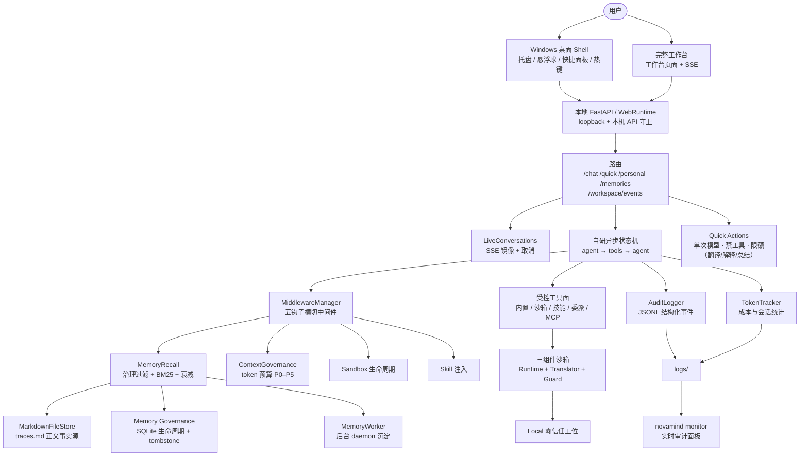

# NovaMind

> **面向工作、学习和日常生活的个人 Agent，深度研究是其优化方向。**
> 保留可审计内核、工具、技能、沙箱与受控长期记忆。

NovaMind 不是一个只会在浏览器里聊天的套壳应用。它在 Windows 上提供统一的桌面入口——完整工作台、可拖动悬浮球、快捷面板、系统托盘、全局热键和日程提醒——这些入口共享同一个 Agent Runtime、同一份会话、同一套记忆与权限边界。底层保留自研异步状态机、五钩子横切中间件、五层记忆、三组件沙箱、三层技能与 token 预算治理。

- **当前版本**：3.0.0
- **Python**：3.12 – 3.13
- **协议**：MIT License
- **优先平台**：Windows（macOS / Linux 使用工作台入口，桌面 Shell 细节待适配）

[核心能力](#核心能力) · [系统架构](#系统架构) · [快速启动](#快速启动) · [运行命令](#运行命令) · [桌面与个人功能](#桌面与个人功能) · [记忆与治理](#记忆与治理) · [安全模型](#安全模型) · [配置说明](#配置说明) · [项目结构](#项目结构) · [开发与测试](#开发与测试) · [常见问题](#常见问题) · [文档索引](#文档索引)

---

## 核心能力

| 能力 | 当前实现 |
| --- | --- |
| **统一桌面入口** | 一个进程同时管理工作台、悬浮球、快捷面板、托盘、全局热键与提醒；二次启动唤醒既有实例，不重复起后端。 |
| **自研编排** | 自定义异步状态机负责 `agent → tools → agent` 条件路由；核心循环保持薄，横切逻辑抽到中间件。 |
| **横切中间件** | 五个钩子（`before/after_agent`、`before/after_model`、`wrap_tool_call`）承载记忆召回、技能注入、沙箱生命周期、上下文治理、多 Agent 打点。 |
| **受控长期记忆** | 五层结构（Schema → 衰减 → BM25 检索 → 注入 → 后台沉淀）+ 候选/确认/禁用/删除/版本屏障；自动抽取只生成候选，不自动替换用户已确认记忆。 |
| **LLM 链式降级** | `ModelRouter` + `FallbackChatModel`：多 provider 链式降级，只切瞬时错误（超时/限流/5xx），`is_default` provider 恒在链尾。 |
| **上下文治理** | token 预算穿透真实窗口 + P0–P5 分段舍弃（外化 / 摘要 / 快照 / 熔断）。 |
| **三组件沙箱** | Runtime + PathTranslator + SecurityGuard；Local 零信任白名单；Docker 组件存在但未列入默认运行模式。 |
| **技能与个人方法学习** | 37 个内置技能 + SQLite 版本血缘 + 四计数器；个人方法从重复任务整理为候选，审阅后试用/启用，支持回退。 |
| **多 Agent 委派** | `delegate_to_pi` 自动接线（pi 可用时）；provider/model 可配；共享沙箱设计就绪。 |
| **图片对话** | 工作台与快捷面板共享附件组件：PNG / JPEG / 静态 WebP，每条最多 3 张；服务端校验、纠正 EXIF、缩放并转 JPEG；视觉能力取决于所配模型。 |
| **日程与提醒** | 提醒/待办 CRUD、重复频率、提前提醒分钟数；程序运行期间由托盘提醒，可选开机自启（仅打包 exe）。 |
| **可审计 + 本机安全** | 关键步骤写结构化 JSONL；loopback 绑定 + Host/Origin 白名单 + 会话 Cookie/Token；记忆删除走 tombstone，后台抽取不能复活。 |

---

## 系统架构



### 一次对话如何执行

1. 桌面入口或工作台把消息交给本地 FastAPI；后端仅绑定 loopback，并经过 Host/Origin/会话校验。
2. `MemoryRecallMiddleware` 召回相关长期记忆（BM25 + 衰减强度 + 中文分词），再按治理状态过滤：只有 `ACTIVE`、未墓碑、未被替代的内容才会注入。
3. `ContextGovernanceMiddleware` 用真实窗口计算 token 预算；超长工具结果外化，接近上限时摘要或熔断。
4. 状态机经 `ModelRouter` 调用 LLM；需要工具时进入 `tools` 节点，工具执行走 `wrap_tool_call`。
5. 工具调用先过 `HarnessPolicy` 与沙箱校验；允许的调用进入内置工具、技能、委派或沙箱。
6. 会话、记忆与治理状态落盘到 `workspace/`；审计事件与 Token 统计写入 `logs/`。
7. 同一次对话可通过 `/workspace/events` 镜像到工作台与快捷面板；`/workspace/turns/{id}/cancel` 可取消在飞轮次。

### 关键设计边界

| 层级 | 负责什么 | 不负责什么 |
| --- | --- | --- |
| **横切中间件** | 把记忆/技能/沙箱/治理等横切关注点从核心循环剥离。 | 不把业务逻辑塞进状态机本体。 |
| **五层记忆 + 治理** | 长期知识的衰减、检索、注入、沉淀，以及候选/确认/删除生命周期。 | 不做实时对话的短期窗口管理（那是上下文治理的事）。 |
| **零信任沙箱** | 文件与命令操作收敛到工位/挂载区，拦截逃逸。 | 不提供宿主机任意访问或任意命令执行。 |
| **三层技能** | 技能的存储、选择、进化与评估。 | 不替代业务逻辑本身。 |
| **审计与诊断** | 记录并展示输入、上下文、工具、策略、Token、退化信号。 | 不替代外部可观测性平台。 |

---

## 快速启动

以下以 Windows PowerShell 为例；macOS / Linux 将虚拟环境激活命令替换为 `source venv/bin/activate`。

### 1. 创建虚拟环境

```powershell
cd D:\claudecode\NovaMind
python -m venv venv
.\venv\Scripts\Activate.ps1
python -m pip install --upgrade pip
```

> 项目要求 Python 3.12 或 3.13（`requires-python = ">=3.12,<3.14"`）。3.14 因 langchain-openai 导入期 SSL 兼容问题暂不支持。若 PowerShell 阻止激活脚本，可执行 `Set-ExecutionPolicy -Scope Process Bypass`，或直接使用 `venv\Scripts\python.exe`。

### 2. 安装

```powershell
python -m pip install -e .
python -m pip install -e ".[dev]"      # 运行测试
python -m pip install -e ".[ollama]"   # 使用 Ollama 本地模型
```

安装后提供 `novamind` 命令；等价入口为 `python -m entry.cli --help`。

### 3. 配置模型

```powershell
novamind config
```

向导选择 provider、模型、API Key 与可选 Base URL，写入项目根目录 `.env`。图片对话需要所配模型实际支持视觉；不支持时界面会提示，不会伪造识图结果。

### 4. 启动

```powershell
novamind doctor          # 架构健康体检
novamind gui             # Windows：统一桌面（工作台 + 悬浮球 + 托盘 + 热键）
novamind run             # 命令行交互
```

Windows 上 `novamind gui` 默认启动统一桌面；`novamind desktop` 是兼容入口，行为一致。其他平台回退为工作台窗口。

打包后的程序直接运行，不需要 `--desktop` 参数：

```powershell
dist-personal-ui\nova-mind-gui.exe
```

关闭工作台或快捷窗口只是收起，**从托盘选择“退出”才真正退出**。第二次启动会唤醒既有实例，不会重复起后端。

---

## 运行命令

| 命令 | 用途 |
| --- | --- |
| `novamind config` | 交互式配置向导，写入 `.env`。 |
| `novamind doctor` | 架构健康体检：provider / 记忆 / 技能 / 沙箱 / 中间件 + 退化信号。 |
| `novamind doctor --json` | JSON 输出；出现 error 返回非零退出码，适合脚本或 CI。 |
| `novamind gui` | Windows：启动统一桌面（工作台、悬浮球、快捷面板、托盘、热键、提醒）。后端只绑定 loopback，启用本机 API 守卫与并发容量限制。 |
| `novamind desktop` | 统一桌面的兼容入口；与 `gui` 行为一致。 |
| `novamind run` | 交互式 Agent 主循环。 |
| `novamind run --thread-id demo` | 使用指定 `thread_id` 运行或恢复会话。 |
| `novamind monitor --list` | 列出可监控的会话。 |
| `novamind monitor --thread-id demo` | 另开终端实时查看审计事件与 Token 信息。 |

### 工作台页面

| 页面 | 后端接口 | 展示内容 |
| --- | --- | --- |
| 聊天 | `/chat` + `/workspace/events` | 多轮对话、图片附件、流式输出、停止/取消、会话镜像 |
| 技能 | `/skills` | 37 个内置技能 + 四计数器 + `effective_rate` + 学习候选 |
| 日程 | `/personal/schedules` | 提醒/待办 CRUD、重复频率、提前提醒、完成/取消 |
| 个人设置 | `/personal/settings` | 外观、表达风格、记忆开关、悬浮球/热键/自启、学习开关 |
| 记忆 | `/memories` + `/settings/memory` | 候选/生效/禁用/拒绝/删除、来源、版本、召回与自动抽取开关 |
| 审计 | `/monitor/sessions` + `/monitor/events/{id}` | 会话日志列表 + 审计事件流（工具调用/Token/策略拦截/AI 回复） |
| 诊断 | `/doctor` | 分层体检报告（error/warning/info + 健康状态） |

### 推荐工作流

**日常快捷使用**：保持桌面 Shell 驻留 → 左键点悬浮球打开快捷面板，或在右键菜单中选择动作 → 需要继续时转入完整工作台。

**长时间任务**：在工作台对话，用“停止”取消在飞轮次；需要观察执行细节时打开审计页或另开 `novamind monitor`。

**CLI 双终端**：

```powershell
novamind run --thread-id demo        # 终端 A
novamind monitor --thread-id demo    # 终端 B
```

---

## 桌面与个人功能

### 统一桌面

- **悬浮球**：可拖动、吸附边缘、隐藏/显示、重置位置；支持尺寸、透明度、主题、强调色、自定义图标。
- **快捷面板**：助手对话、翻译、解释、总结、记录日程。翻译/解释/总结是单次模型调用（不绑定工具、20k 字符上限、30 秒超时、并发上限、断连取消）；助手对话与记录日程走完整 Agent，记录使用真实日程工具。
- **功能菜单**：右键悬浮球（或键盘菜单键）打开功能菜单，包含问 NovaMind、翻译、解释、总结、记录、完整工作台和设置；左键点击悬浮球直接打开快捷面板。菜单选择翻译/解释/总结时会尝试捕获前台选中文本，无法安全获取时回退手动粘贴。
- **托盘菜单**：打开完整工作台、打开快捷面板、隐藏/显示悬浮球、退出。
- **全局热键**：默认 `Ctrl+Shift+Space`，可在个人设置中修改；注册失败会显示冲突提示，而不是静默失败。
- **单实例**：第二次启动通过 loopback `/shell/wake` 唤醒既有实例（带会话 Token），不重复持有数据库或端口。

### 图片对话

- 支持 PNG、JPEG、静态 WebP；每条消息最多 3 张，每张最大 10 MiB，解码上限 2000 万像素。
- 服务端校验真实图片格式、纠正 EXIF 方向、将最长边缩至 2560 并转换为受控 JPEG；透明背景不保留。
- 历史中保存资源引用与多模态结构；真正调用模型前才解析为图片数据。
- 视觉调用失败会提示检查模型能力；没有 OCR 降级，也不伪造识别结果。
- 失败或停止会保留当前输入草稿与图片；图片消息不会自动进入后台记忆候选，明确要求记住时走受控记忆工具。
- 未发送、未设为图标的草稿超过 7 天会清理；已发送图片与已保存图标不参与清理。

### 日程与提醒

- 支持一次性提醒、待办（无时间）、按小时/天/周/月重复、剩余重复次数、提前提醒分钟数。
- 程序运行期间由托盘提醒；不会注册第二个后台服务。需要开机自启时在个人设置中显式开启（仅打包 exe 写入 HKCU Run）。

### 个人设置

| 分区 | 内容 |
| --- | --- |
| 外观 | 系统/浅色/深色主题 |
| 表达风格 | 默认 / 简洁 / 详细 / 温和 / 正式 / 自定义 |
| 记忆 | 召回开关、自动抽取候选、注入 token 预算 |
| 学习 | 是否观察重复任务、最小样本数、保留天数、观察上限、冷却天数 |
| 桌面 | 悬浮球可见/启动显示、自启、打开工作台、尺寸、透明度、主题、强调色、图标、吸附、动画、状态、热键、位置 |

### 隐私与记忆模式

每次对话可带 `memory_mode`：

- `normal`：正常召回与写入；
- `no_record`：本次不写入新记忆；
- `private`：不召回、不写入。

图片、个人设置与日程都落在本地 `workspace/`，不上传到第三方服务；只有调用模型时才会把必要内容发给所配 provider。

---

## 记忆与治理

### 五层结构

1. **Schema**：不可变 `MemoryTrace` + 认知类型（episodic / semantic / procedural）。
2. **衰减遗忘**：艾宾浩斯公式懒计算 + TTL/强度双规则。
3. **存储检索**：`traces.md` 为正文事实源；BM25 + jieba 中文分词 + 检索命中强化写回。
4. **注入**：模型调用前以本轮 `HumanMessage` 注入，不写 system prompt，保护缓存。
5. **后台沉淀**：daemon 线程抽取候选；攒够阈值后合并为语义知识，旧痕迹标 `forgotten`。

> 当前默认召回是**词法检索**（BM25 相似度 + 强度），不是“向量 + 图谱”的混合系统。`MemoryConfig` 预留了 `vector_store` / `graph_store` 适配位，默认空，不启用。

### 生命周期

```
Proposed ──confirm──▶ Active ──disable──▶ Disabled ──enable──▶ Active
   │                    │
   ├──reject──▶ Rejected│
   └──delete──▶ Deleted ◀┘（tombstone 永久屏障）
Active ──supersede(old→new)──▶ Disabled(superseded_by=new)
```

- 自动抽取只产生 **Proposed**；用户确认后才进入召回。
- 删除写 **tombstone** 并把正文标 `forgotten`；后台 worker 在 encode 前按内容哈希拦截，不能复活。
- 编辑正文生成新版本：新 trace 生效、旧 trace 失效、revision 历史保留。
- 冲突用 `supersede`：旧值作废，避免两条矛盾偏好同时注入。
- 信任分级：`user` / `conversation` / `untrusted`；不可信来源必须显式确认才可能生效。

### Memory Center

工作台“记忆”页可查看候选、生效、禁用、拒绝、删除记录，编辑正文/分类/范围，查看 revision 历史，并切换召回与自动抽取。旧画像会经受控迁移进入治理体系，不再绕过记忆中心独立注入；支持导出与彻底清理。

---

## 安全模型

- **loopback 不等于安全**：桌面入口启用本机 API 守卫——Host 白名单（防 DNS rebinding）、Origin 有值时必须是 loopback、写请求要求 `SameSite=Strict` 会话 Cookie 或 `X-NovaMind-Token`。
- **Local 沙箱（默认）**：文件操作收敛到工位目录，路径穿越被拒绝；Shell 仅白名单命令（`pwd/echo/ls/dir/cat/type/mkdir`），拦截元字符、环境变量展开与解释器逃逸。`NOVAMIND_SANDBOX_MODE` 仅支持 `local`，未知值启动即拒绝。
- **Docker 沙箱（组件存在，未列入默认）**：provider / warm pool / WSL executor / 挂载区路径强制均有实现与 mock 测试；仓库尚无 `novamind-sandbox:latest` 沙箱镜像定义、未做真实 smoke，因此不宣称 Docker 为默认运行模式。
- **策略层**：`HarnessPolicy` 定义允许工具与高风险确认关键词，命中即拦截或写审计。
- **降级安全**：只切瞬时错误；401/400 不降级，避免把密钥发给错误 provider。
- **图片边界**：服务端校验真实格式与像素上限，统一转码；不信任文件名或客户端声明。
- **记忆边界**：删除/禁用/拒绝优先于衰减与评分；不可信来源不能自动升级为长期指令。
- **并发语义**：同一 thread 的对话/删除互斥，不同 thread 并发重叠；取消/断连回滚半轮状态并恰好释放沙箱；批量持久化单事务提交。
- **审计脱敏**：日志写入前对 `api_key/token/secret/password` 等字段做 `[REDACTED]` 处理，并限制超长内容。

---

## 配置说明

配置文件为项目根目录 `.env`；不要提交真实密钥。

```dotenv
DEFAULT_PROVIDER=openai
DEFAULT_MODEL=gpt-4o-mini
OPENAI_API_KEY=sk-...
```

### 链式降级

通过 `ProviderProfile` 注册多个 provider 即可：瞬时错误自动切下一个，`is_default` provider 恒在链尾兜底。新增一家 provider 只需在注册表追加配置并补环境变量，不改核心循环。

### 运行时环境变量

| 变量 | 说明 | 默认值 |
| --- | --- | --- |
| `NOVAMIND_WORKSPACE` | 运行时工作空间位置。 | `<project>/workspace` |
| `NOVAMIND_DATA_ROOT` | 打包 exe 的数据根（`workspace/`、`logs/` 的父目录）。 | exe 上一级目录 |
| `NOVAMIND_ENV` | 显式指定 `.env` 路径。 | 自动探测 |
| `NOVAMIND_LOG_LEVEL` | `DEBUG` / `INFO` / `WARNING` / `ERROR`。 | `INFO` |
| `NOVAMIND_LOG_QUEUE_SIZE` | 审计日志有界队列容量。 | `10000` |
| `NOVAMIND_SANDBOX_MODE` | 沙箱模式；当前仅支持 `local`。 | `local` |
| `NOVAMIND_SANDBOX_EXECUTOR` | 设为 `wsl` 时启用 WSL2 路径执行器。 | 关闭 |
| `NOVAMIND_WEB_MAX_MODELS` | 工作台并发模型调用容量。 | `4` |
| `NOVAMIND_WEB_BODY_LIMIT` | 请求体上限（字节）。 | `1048576` |
| `NOVAMIND_WEB_SHUTDOWN_TIMEOUT` | 关闭时在飞任务等待秒数。 | `5` |
| `NOVAMIND_LOCAL_GUARD` | 本机 API 守卫开关；桌面入口会启用。 | `0` |
| `NOVAMIND_SKILL_EVOLUTION` | 技能自进化 L2/L3 开关（`on` 开启）。 | 关闭 |
| `NOVAMIND_MULTIAGENT_EVOLUTION` | 多 Agent L2/L3 开关（`on` 开启）。 | 关闭 |
| `NOVAMIND_PI_COMMAND` | pi CLI 命令/完整路径。 | PATH 自动探测 |
| `NOVAMIND_PI_PROVIDER` | 委派时 pi 使用的 provider。 | pi 默认 |
| `NOVAMIND_PI_MODEL` | 委派时 pi 使用的 model。 | pi 默认 |
| `NOVAMIND_RUN_PAID_TESTS` | 设为 `1` 才允许真实模型付费测试。 | 关闭 |
| `NOVAMIND_DEBUG_MSGS` | 压测计量输出调试信息。 | 关闭 |

### 数据位置

```text
workspace/
├── state.sqlite3              # 会话与摘要（短期）
├── memory_traces/traces.md    # 长期记忆正文事实源
├── memory_governance.sqlite3  # 记忆生命周期/墓碑/revision
├── skill_store.sqlite3        # 技能库
├── attachments/               # 图片资源（服务端转码后的 JPEG）
├── personal_settings.json     # 个人设置
├── desktop_settings.json      # 悬浮球位置/可见性
└── tasks.json                 # 定时提醒/待办
logs/                          # JSONL 审计日志
```

`.env` 读取优先级：`NOVAMIND_ENV` 显式 → exe 同目录 → exe 上一级（项目根）→ 源码根 → `~/.novamind/.env` → 当前目录。

---

## 项目结构

```text
NovaMind/
├── entry/                          # CLI 入口、monitor、doctor
│   ├── cli.py                      # config / run / gui / desktop / monitor / doctor
│   └── monitor.py                  # Rich 实时审计面板
├── novamind/core/
│   ├── agent.py                    # create_agent_app 组装
│   ├── state_machine.py            # 自研异步状态机 + 会话持久化
│   ├── llm/                        # ProviderProfile / FallbackChatModel / ModelRouter
│   ├── middlewares/                # 五钩子协议 + 记忆/治理/沙箱/编排中间件
│   ├── memory/                     # 五层记忆 + 治理 + 迁移
│   ├── sandbox/                    # 三组件沙箱（Local / Docker / WSL2）
│   ├── context_engineering/        # token 预算 + P0–P5
│   ├── skill/                      # 技能库 / 选择 / 进化 / 评估 / 37 内置
│   ├── multiagent/                 # 委派 / 共享沙箱
│   ├── personal.py                 # 个人设置与请求上下文
│   ├── personal_upgrade.py         # 一次性非破坏快照与旧画像迁移
│   ├── images.py                   # 图片校验/转码/引用
│   ├── schedules.py                # 提醒/待办
│   └── tools/                      # 内置工具与沙箱工具
├── novamind/webui/
│   ├── server.py                   # FastAPI + SSE + 统一错误/分页
│   ├── runtime.py                  # WebRuntime / 容量 / 关闭顺序
│   ├── live.py                     # 工作台对话镜像与取消
│   ├── personal_routes.py          # 设置/图片/日程/记忆命令
│   ├── local_guard.py              # Host/Origin/Cookie 守卫
│   ├── quick_actions.py            # 单次翻译/解释/总结/改写
│   ├── skill_runtime.py            # 技能目录中间件
│   ├── app.py                      # pywebview 工作台窗口
│   └── static/                     # 工作台/快捷面板/悬浮球前端
├── novamind/desktop/
│   ├── shell.py                    # 托盘 + 悬浮球 + 快捷面板 + 热键 + 单实例
│   ├── win32_shell.py              # 原生托盘/热键消息循环
│   ├── bubble_surface.py           # 逐像素透明悬浮球
│   ├── single_instance.py          # 命名互斥量 / flock
│   ├── selection.py                # 划词捕获（best-effort，手动粘贴兜底）
│   ├── autostart.py                # 打包 exe 的可选自启
│   ├── geometry.py / ui_thread.py  # DPI / UI 线程
│   └── assets/                     # 图标
├── workspace/                      # 运行时数据（默认）
├── logs/                           # 审计日志
├── docs/                           # 设计/验收/审计文档
├── harness/policies.json           # 工具许可与确认策略
├── tests/                          # unit / integration / functional / gui / performance
├── packaging/gui_entry.py          # 打包入口（默认工作台；--desktop 兼容）
├── NovaMind.spec                   # PyInstaller 配置
└── pyproject.toml                  # 依赖唯一事实源
```

---

## 开发与测试

依赖唯一事实源是 `pyproject.toml`；`requirements.txt` 由 `uv export` 再生，禁止手改。

```powershell
uv sync --extra dev
uv run --no-sync pytest tests -q --ignore=tests/functional   # 常规离线回归
uv run --no-sync pytest tests/unit -q                         # 单元层
uv run --no-sync pytest tests/integration -q                  # 集成/端到端层
node --test tests/integration/*.test.js                       # 前端逻辑测试
uv run --no-sync ruff check novamind entry tests              # Lint（CI 强制）
uv run --no-sync mypy novamind/core/policy.py novamind/core/token_tracker.py \
  novamind/core/event_bus.py novamind/core/task_store.py \
  novamind/core/skill/types.py novamind/core/sandbox/types.py  # 类型检查（首批）
uv run --no-sync mypy novamind/core/middlewares/sandbox_middleware.py \
  novamind/webui/api_models.py novamind/webui/runtime.py \
  novamind/core/context.py                                     # 类型检查（第二批）
novamind doctor --json                                        # 运行时自检
```

可选：`uv run --no-sync pre-commit install` 启用 Git 钩子（提交前 ruff、推送前单元冒烟）。

### 当前测试状态（2026-11-01 实测）

| 项 | 结果 |
| --- | --- |
| 常规回归（unit + integration） | **982 passed / 3 skipped / 2 subtests passed** |
| 覆盖率 | **79.07%**（CI 底线 `--cov-fail-under=78`） |
| 前端 Node | **45 passed** |
| Ruff | 全绿 |
| 功能验收（真实 LLM） | `tests/functional` 共 37 项；缺 key 自动跳过，发布前手动执行 |
| Docker smoke | opt-in，需 daemon + 镜像；不可用时 skip |
| 真实模型压测 | opt-in，需 `NOVAMIND_RUN_PAID_TESTS=1` 与预算确认 |

> 自动化回归不覆盖真实供应商识图效果、鼠标点击验收或跨设备全场景；相关边界与历史轮次见 [docs/INDEX.md](docs/INDEX.md)。

**发布前必跑**：

```powershell
uv run --no-sync pytest tests/functional -q
```

CI 不跑 functional；它是发布前手动门禁。

### 打包桌面应用

```powershell
pip install pyinstaller
pyinstaller NovaMind.spec --distpath dist-personal-ui --workpath build/personal --noconfirm
# 唯一桌面交付入口：dist-personal-ui/nova-mind-gui.exe（单文件）
```

- 打包前请从托盘退出正在运行的程序，避免文件占用。
- 产物无参数启动统一桌面；`--desktop` 保留为兼容参数。
- 数据根默认为 exe 上一级目录（项目根），`.env` 自动读取项目根那份，无需复制到打包目录。
- `NovaMind.spec` 显式排除 `PySide6` / `PyQt6`，避免 PyInstaller 因可选 Qt 后端把实验依赖收进包。

### 覆盖领域

| 层 | 覆盖不变量 |
| --- | --- |
| **LLM 降级** | 只切瞬时错误、401/400 不降级、`is_default` 恒在链尾、真实窗口解析 |
| **中间件** | 钩子按序调用、结果合并、默认无中间件时行为不变 |
| **记忆** | lazy decay、检索强化、forgotten 过滤、encode 幂等、中文分词 |
| **记忆治理** | 候选不注入、确认生效、删除墓碑不复活、禁用/拒绝即时、冲突不双注入、revision 并发 |
| **沙箱** | 路径穿越/越权写入拒绝、元字符拦截、命令白名单、Docker 挂载区、warm pool |
| **上下文治理** | 真实窗口解析、P1 外化、P4 摘要、P5 熔断 |
| **技能** | version DAG、计数器、进化闭环、棘轮回滚、契约检查 |
| **多 Agent** | 委派工具生成/接线、pi 检测与 shim 绕过、错误归一化、UTF-8 解码 |
| **工作台/桌面** | 会话隔离、取消、分页、本机守卫、单实例唤醒、悬浮球/菜单契约 |

---

## 常见问题

### `novamind` 不是内部或外部命令

在已激活的虚拟环境中执行 `python -m pip install -e .`，或直接 `python -m entry.cli run`。

### 启动时提示模型配置缺失

执行 `novamind config`，检查 `.env` 的 `DEFAULT_PROVIDER`、`DEFAULT_MODEL` 与对应 API Key。

### 悬浮球/快捷面板没出现

- 托盘菜单选择“打开快捷面板”或“显示悬浮球”；
- 个人设置 → 桌面，确认 `bubble_visible` / `startup_bubble`；
- 热键被占用时设置页会显示冲突，改一个组合键；
- 确认程序已完全退出后重新启动，避免残留实例。

### 第二次双击没反应

这是单实例行为：第二次启动会唤醒既有实例并退出，不再起第二套后端。从托盘选择“退出”才会真正关闭。

### 图片无法识别

先确认所配模型支持视觉。服务端只负责校验、转码与传递图片；模型不支持时会提示，不会伪造结果，也没有 OCR 降级。

### 文件或 Shell 操作被拒绝

检查目标是否在工位/挂载区、命令是否在白名单、是否命中策略确认关键词。运行 `novamind doctor` 并查看 `logs/` 最近事件。

### 中文记忆检索不到

确认已安装 `jieba`；缺失时会回退空格分词，中文召回会退化。可运行 `uv run --no-sync python -c "import jieba"` 验证。

### 删除的记忆又出现了

正常情况不会：删除会写 tombstone，后台 worker 在 encode 前拦截。若从备份恢复过 `workspace/`，请同时恢复 `memory_governance.sqlite3`；只恢复 `traces.md` 会绕过墓碑。可在记忆中心确认状态。

### 本机 API 返回 403

桌面入口启用了 Host/Origin/会话校验。请通过工作台或快捷面板访问；不要从其他站点跨源调用 `127.0.0.1`。脚本调用需要携带会话 Cookie 或 `X-NovaMind-Token`。

### 端口被占用

后端会从 8765 起自动顺延最多 10 个端口；也可用 `novamind gui --port 9000` 指定。

---

## 文档索引

- [Personal Agent 实施说明](docs/PERSONAL_AGENT_IMPLEMENTATION.md)：统一桌面、图片、日程、记忆控制与迁移的初次实现记录。
- [GUI 优化记录](docs/GUI_REFINEMENT_REPORT.md)：桌面可见性、助手入口、控件与真实离线检查。
- [迭代记录 2026-10-24](docs/ITERATION_POLISH_2026-10-24.md)：个人使用优化、Pillow 13 升级与实际验证。
- [个人技能学习设计](docs/PERSONAL_SKILL_EVOLUTION_DESIGN.md) / [交付记录](docs/PERSONAL_SKILL_EVOLUTION_DELIVERY_2026-10-25.md)：观察、候选、审阅、验证、发布与回退。
- [B0 记忆治理审计](docs/B0_MEMORY_GOVERNANCE_AUDIT.md)：链路、状态机、墓碑、迁移与反例测试。
- [VNext 迭代验收](docs/VNEXT_ITERATION_REPORT.md)：桌面/快捷面板/记忆中心/个性化召回与评测。
- [Web API 契约](docs/webui-api.md)：请求/响应、错误形状、分页与 SSE。
- [依赖审计](docs/DEPENDENCY_AUDIT_2026-10-22.md)：剩余依赖风险。
- [压测说明](tests/performance/README.md)：隔离实例、预算保护与真实模型压测。
- [文档总索引](docs/INDEX.md)。

---

## 致谢

NovaMind 的架构对齐 [Poirot](https://github.com/earendil-works/poirot)——一个认真做架构的深度研究 Agent。感谢其开源内核提供的设计参考。

- [LangChain](https://python.langchain.com/)：模型与工具调用抽象
- [pywebview](https://pywebview.flowrl.com/)：桌面窗口
- [Pillow](https://python-pillow.org/)：图片校验与转码
- [Rich](https://github.com/Textualize/rich)：终端监控与展示
- [Typer](https://typer.tiangolo.com/)：命令行接口
- [jieba](https://github.com/fxsjy/jieba)：中文分词

## License

[MIT License](LICENSE)
