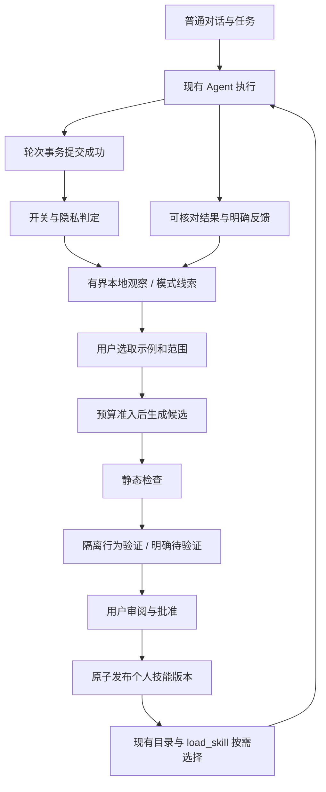

# NovaMind：从日常对话沉淀个人技能的实施方案

方案日期：2026-10-24（Asia/Hong_Kong）｜版本：v0.1｜状态：**已获用户批准并实施，离线门禁完成**。2026-10-25 实际交付、限制及打包状态见 [实现记录](PERSONAL_SKILL_EVOLUTION_DELIVERY_2026-10-25.md)。下文保留原设计与审批边界，不能把其中设想当成实测结果。

本文回答：同类事情在日常对话中反复出现，NovaMind 如何从实际经历与用户纠正中整理出可靠方法，保存为技能，并在以后按需使用。

## 1. 先看最终体验与本次审批范围

### 1.1 你会怎样使用

1. 在个人设置开启一次“从日常任务发现可复用方法”。此后普通对话照常进行，本地观察不额外调用模型。
2. 同类任务积累到一定程度，技能页出现一个安静的建议，例如“你最近多次按相同方式整理论文，可以整理为个人技能”。不反复弹窗。
3. 点击“整理为技能”，先看到拟采用的会话片段、纠正要求和结果反馈，可移除不适合的示例、选择作用范围。涉及额外模型调用时显示模型、调用上限和预算，确认后才开始。
4. NovaMind 生成中文可读的技能候选：何时使用、输入参数、步骤、输出格式、检查办法，以及何时不要使用。人名、日期、路径等实例细节替换成参数。
5. 你审阅候选和验证结果后，选择启用、修改、暂存或拒绝。材料不足时可明确选择“未充分验证，先试用”，不会被标为验证通过。
6. 以后遇到相关任务，沿用现有技能目录与加载机制按需使用。你可以查看此次使用的个人技能，关闭、编辑或回退版本。

举例：你多次纠正论文整理方式为“先讲研究问题，再比较方法，最后写不足，结论附出处”。系统可整理一项 `learned-paper-reading` 类个人技能；论文题目和具体内容不成为固定指令。

### 1.2 方案审批与产品中的技能审批

两者分别处理：

- **现在的审批**：你先审阅本文。只有你明确批准后，才开始实现产品代码、数据库变更或打包。此次只新增/更新计划文档。
- **将来的技能审批**：产品生成某个技能候选后，由你决定是否启用；批准开发方案不等于提前批准未来所有技能。
- 真实模型验收、后台模型调用须有新批次明确额度；既往压测预算不沿用。免费实现与离线验证可在方案批准后完成，不为新的阶段重复请求同一范围授权。

实施由主代理直接完成，不使用子 agent；不提交/推送 Git、不改用户真实数据做测试。原有七项日常优化仍保留在 `tasks/plan.md`，本方案不自动扩大为同时实施七项。

### 1.3 推荐默认值（随本文一起审阅）

| 项目 | 首版建议 |
| --- | --- |
| 初始开关 | 本地观察默认关闭，用户开启一次后持续生效；可随时暂停和清理 |
| 自动发现 | 本地、无额外 LLM；默认至少 3 个去重任务示例、覆盖至少 2 种具体输入才出现建议 |
| 成功信号 | 优先用户明确反馈和可核对的任务结果；未知保持未知，不以轮次正常结束代替成功 |
| 自动启用 | 关闭；候选发布必须用户确认 |
| 模型费用 | 默认不运行复盘/行为评估；有显式额度才准入 |
| 同时运行 | 最多 1 个学习作业；正常聊天优先，不并行开多组评估 |
| 建议频率 | 同一模式 7 天冷却；拒绝后抑制该模式，除非用户主动重新整理 |
| 未选用观察留存 | 默认最多 30 天且最多 1000 条，以先到者为准；达到上限清理未选用观察，保留必要审计索引；选中内容的临时副本另按 §7.2 清理 |
| 范围 | 默认当前 scope；升级为全局个人技能需显式选择 |

这些数字是待批准的产品初始参数，不是已经测得的最佳阈值，也不构成“重复三次必定学会”的承诺。

## 2. Phase 0：已完成的文档与源码发现

以下核对仅为编写本方案，没有运行付费流程或产品测试。

### 2.1 当前事实

| 事实 | 已读取的依据 | 实施含义 |
| --- | --- | --- |
| 核心执行为 agent → tools → agent 的状态机，CLI/Web 复用内核 | `novamind/core/agent.py` 的 `create_agent_app` 组装；`core/state_machine.py` | 在现有轮次结束处增加受控观察，不更换状态机或另起执行服务 |
| after_agent 在持久化之前调用，钩子或持久化异常会回滚本轮 | `core/state_machine.py::_execute_turn`、`_astream_turn`；`docs/session-model.md` | 不能在 after_agent 直接沉淀经验，必须等提交成功 |
| 五层记忆已有事件/语义/过程分类、治理、scope、revision 和墓碑 | `core/memory/schema.py`、`governance.py`、`document.py` | 个人事实继续使用现有真值链；学习证据不另行成为自动注入的个人事实 |
| 现有检索器是 BM25 + 强度/衰减，没有实际 vector/graph 实现 | `core/memory/strategies/default/retriever.py` | 首版不用“Hybrid”类名宣称已有向量检索，不强制引入向量数据库 |
| 技能正文在文件，SQLite 存引用、版本血缘、开关、计数与评估记录 | `core/skill/types.py`、`store.py`、`parser.py` | 个人技能仍使用 SKILL.md 与已有注册表 |
| EvolutionManager 有聚焦、变异、评估、门禁和创建版本流程；默认桥接评估读取技能文本 | `core/skill/evolution/manager.py`、`eval/programmatic_bridge.py`、`skill/eval/analyzers/response_contract_checker.py` | 可以复用组件，但文本检查通过不能直接当行为提升；不能直接调用会立即发布的旧流程处理待审批候选 |
| 扫描 novamind/entry 未发现生产路径调用 run_cycle/evolve_skill/capture_skill；测试中存在调用 | 同上管理器、`tests/unit/test_skill_evolution_chain.py`、`tests/functional/test_part_b_real.py` | 接线属于新交付，不能把“已有类”写成日常自进化已运行 |
| Web 已按调用注入启用技能目录，通过 load_skill 读取正文 | `webui/skill_runtime.py` | 复用现有工具名称、参数和 UI；为新个人技能增加作用范围、审批和临时正文注入控制 |
| private/no_record 已定义个人记忆读写语义 | `core/personal.py::memory_allowed` | 学习不能成为绕过不记录模式的第二条收集路径 |

表内未写 `novamind/` 的 `core/`、`webui/` 均相对该目录。源码可能继续变化，各阶段实施前只复核该阶段涉及的事实，不据本文覆盖其他改动。

### 2.2 可以复用的真实 API 与必须新增的接口

已存在，可按原契约复用：

- `ConversationStore.save_turn(thread_id, messages, *, summary=None)`：轮次消息/摘要事务持久化，不负责学习发布。
- `SQLiteSkillStore.get/get_active/list_active/get_versions/set_enabled`：读取版本、目录和开关。
- `SQLiteSkillStore.create_version(parent_id, record, origin)`：会立即激活新版本并提交事务；仅可作为发布设计的参考，不能用于保存未审批草稿。
- `SQLiteSkillStore.rollback(skill_id)`：切换同名 active 指针，不包含本方案审批和 scope 检查，不能原样暴露为个人技能回退接口。
- `SQLiteSkillStore.record_selection/record_outcome`：已有指标方法；`record_outcome` 本身没有按 run_id 去重，不能收到重放就重复调用。
- `EvolutionManager.capture_skill/evolve_skill/run_cycle`、`LLMMutator.mutate`、`ProgrammaticEvalBridge.evaluate`：已有编排/生成/静态评估能力；新增审批模式前不直接接到后台定时器。
- `parse_skill_file(skill_file, origin='IMPORTED')`：解析 frontmatter 并可能写 `.skill_id`，只能用于受控目录；用户上传文本不应被当成本地任意路径。
- `build_skill_loader(store)` 和 `SkillCatalogMiddleware`：现有 Web 技能加载接线。
- `memory_allowed(write=False)`、`WebRuntime.register_task/unregister_task/shutdown`：隐私判定和生命周期入口。

下文 `TurnCommittedEvent`、`LearningStore`、`prepare_candidate`、`publish_approved`、学习路由等均为**拟新增设计**，不是声称现有 API 已提供。

## 3. 产品边界与数据流

### 3.1 首版交付

本地观察 → 发现重复模式 → 用户选取示例 → 生成技能候选 → 静态/行为验证 → 用户批准发布 → 按需使用 → 反馈及版本回退。

观察阶段不会额外调用模型。候选生成、可选模型评估均由明确作业触发。旧技能、深度研究、设计、编码、图片、日程、小窗和工作台继续可用。

首版沉淀的是指导现有工具的技能方法。自动生成和执行 Python 插件、自动修改 Agent 源码、模型权重训练、多 Agent 搜索、全量历史扫描及无人值守后台进化不在本次范围。可执行工具资产作为后续独立方案，避免将生成 SKILL.md 宣称为已经扩展了程序执行能力。

### 3.2 认知职责

- **个人记忆**负责“你是谁、你的事实与偏好”，继续走五层记忆和治理系统。
- **学习观察/经验**负责“这次做了什么、用户怎样纠正、哪些结果可核对”，仅供学习与审阅，不直接成为常规聊天上下文。
- **批准的个人技能**负责“以后遇到这种事情怎么做”，通过现有技能机制按需加载。

“回答简短一些”可提示转到既有表达偏好；“每次整理报告都按这套流程”才是技能候选。表达偏好、具体事实、完整方法可以来自同一段对话，但分别处理，不能整体复制为技能。

## 4. 从重复对话发现方法

### 4.1 采集时点与范围

给两条内核执行路径增加一个很小的“提交成功观察”扩展点。拟新增 `TurnCommittedEvent` 包含 run_id、thread_id、已提交消息标识、scope、memory_mode、当时开关状态、工具/技能使用标识及提交时间；只传有界不可变快照。

- 扩展点在 `_persist_state` 返回且 `finalized=True` 后执行。正常结束只代表提交完成，任务结果仍可未知。
- 观察器异常单独记录，不再使已提交轮次回滚或让聊天变成错误；不能在响应路径做 LLM、磁盘全文扫描或等待学习队列腾位。
- 队列有上限；溢出记录安全计数并丢弃该次观察，绝不阻塞聊天。进程崩溃可丢少量尚未落库观察，这是首版明确的 best-effort 边界，不承诺与聊天跨库“恰好一次”。已落库数据以 run_id 幂等。
- 半轮取消、持久化失败、after-hook 失败不保存正文经验。已提交任务中的工具失败或用户后续负反馈，可作为反例；不为了学失败而持久化已回滚的半轮内容。
- 只观察开关启用后的新内容，不启动扫描全部旧会话。用户以后可主动选取允许使用的既有示例。

GUI 的助手对话、主工作台和 CLI 通过共同内核去重。小窗翻译/摘要等直接 Quick Action 首版不自动计数；只有用户显式选取并完成历史续接后才可作为一个来源，不能把 Quick→Agent 导入再算一次任务。

### 4.2 默认最小采集

自动观察只存来源引用、去重指纹、工具/技能标识和有限的模式特征；不复制整段聊天、图片二进制、隐藏模型推理、密钥或工具大正文。候选整理时才读取用户选中的已提交片段，显示待发送摘要并允许剔除。

多轮任务的边界可能不清楚。连续纠正、网络重试和同一条消息的重复提交须归并；不能简单按消息数或 thread 数认定“做了三次”。边界不清只产生待审阅线索，用户可合并或移除示例。

### 4.3 低成本模式发现

首版使用已有中文分词能力、规范化任务词、工具组合和用户标记形成粗分组；日期/路径/文件名参数化。scope 隔离，至少两种具体输入可避免把对同一输出的反复修改当成通用规律。

- 重复出现与已纠正的要求分别展示，用户决定是否属于同一种方法。
- 没有共同流程的闲聊、问候、孤立事实，不形成技能建议。
- 失败示例帮助描述禁忌和适用边界，不能因数量多而被当作成功方法。
- 首版不加 embeddings/图数据库；分组误差由审阅纠正。若日后证明确有语义召回瓶颈，再单独评估升级。
- 阈值和冷却到达仅生成本地建议。忽略建议不追加提醒；拒绝记录抑制指纹，重启也不反复出现同一建议。

## 5. 生成候选、验证与发布

### 5.1 候选结构

候选使用 SKILL.md，必含现有解析器要求的 `name`、中文 `description`；正文统一包含：

1. 适用任务与不适用条件。
2. 输入参数及缺失时如何询问。
3. 执行步骤、工具使用边界。
4. 预期输出格式。
5. 可核对的完成标准。
6. 常见失败与处理方法。

来源关系、用户审批、scope、验证状态等放数据库元数据，不把整份原始经历塞进技能。所有参数替换需用户可见；“从未验证过的规则”不能被生成器包装成已证明有效。

候选可以新建个人技能或改进已有个人技能。首次基于内置技能整理个人方法时，创建独立 `learned-` 命名空间和来源关系，保留内置版本及其开关。模型无权扩大 allowed_tools、修改系统规则或创建全局同名覆盖。

### 5.2 三种证据状态

| 状态 | 能说明什么 | 发布方式 |
| --- | --- | --- |
| 静态检查通过 | 文件格式、必需章节、参数、长度和权限边界满足规则 | 仍不能宣称任务效果更好 |
| 行为证据不足/部分验证 | 有候选但缺独立样本、没有额度或测试未完成 | 可暂存；用户明确确认后可“试用”，醒目标注未充分验证 |
| 行为验证通过 | 在明确列出的有限样本上符合标准，更新版本未出现该样本集上的退步 | 用户审阅后启用，展示覆盖范围；不承诺所有未来任务都会更好 |

静态失败、行为已证实失败、权限违规、内容污染的候选不得通过“试用”绕过。未知结果不当成功，用户未点反馈不当认可。

### 5.3 行为评估怎样做

- 比较对象：新技能使用“不加载该技能”的当前基线；更新技能使用创建候选时的旧版本。模型、思考档位、工具条件和任务输入对齐，记录版本/参数；不能把不同模型的提升归因于技能。
- 样本分开：用于整理方法的示例，与用于检验方法的保留样本分开；至少包含变化输入和适用边界反例。建议首个候选准备约 3–5 个相关检查，其中至少 1 个未用于生成；更新时另外检查旧版已支持的代表场景。样本数量是首版预算内建议，不能伪称统计显著。
- 有明确输出结构时优先程序检查；真实任务执行时核对结果，而非只查看候选是否写了“必须引用”。主观质量可由用户评价，模型评审仅为辅助证据。
- 使用隔离工作区与受控工具替身/沙箱，禁止把历史命令、日程创建、网络写入等原样重放到真实环境。若工具被替身代替，只能宣称验证了替身覆盖的行为。
- 没有可用模型/额度时，离线测试证明的是实现流程正确，候选保持未充分验证，不生成虚假行为分数。
- 多个候选轮流尝试属于额外成本；首版一次只生成一个候选，不自动运行无限变异搜索。

### 5.4 用户审阅

审阅页展示：拟沉淀的方法、选用来源、参数化改动、适用 scope、权限、与旧版的差异、实际做过的检查、未验证项，以及本次费用/未知费用。

用户修改正文或作用范围后，候选 revision/hash 更新，旧行为评估失效，重新静态检查；旧审批也失效。发布携带候选 revision/hash 和 expected_base_id，防止批准的内容与启用内容不同。

已发布版本不可原地编辑。编辑已发布技能必须产生新候选，走同样审阅流程，不能借 PATCH 接口修改正在使用的文件。

### 5.5 发布事务与文件一致性

候选不进入现有 active 注册表。拟在既有 skill_store.sqlite3 增加学习相关表，共用受控连接/锁和明确事务入口，使“创建技能版本、切换 active、写批准/发布记录”在同一事务提交。

技能文件先写受控临时目录并校验 hash，再原子落到不可变版本目录；数据库随后事务引用已存在的文件。文件失败不动 active；数据库失败仅留下未引用文件并记录待清理，不能提前删除旧版。清理只处理已证明不被引用的文件。

**不能在新的外层事务中直接嵌套现有 create_version**：该方法自带锁和 commit。实施时需抽出小的内部事务原语或新增公开的发布事务方法，保持旧调用契约；不得直接从外部私拿 `_conn` 绕过锁。

发布前重新读取当前 active、enabled 和候选 revision；不覆盖并发变更。重复批准同一发布请求返回相同版本。已被用户关闭的技能，发布新版不悄悄重新打开；启用需显式选择。

## 6. 运行时使用、效果反馈与回退

### 6.1 选择和注入

- 复用现有目录和 `load_skill(skill_id)` 的参数契约。只有已发布、启用、scope 匹配、未撤销的个人技能可见。
- 对新个人技能，load_skill 只登记本轮选中的版本引用，返回选择状态；正文由拟新增的按调用中间件临时注入，调用前重新校验开关、scope、hash 和来源状态，不写入持久化聊天历史。
- 这样关闭/更新个人技能后，旧会话不会继续携带一份作为执行指令的完整旧正文。已有普通导入技能保持原契约；显式用户引用的历史文本仍作为数据，不宣称模型能够“忘掉看到过的所有内容”。
- 同一选择策略供 Web/CLI 使用，强制 skill overrides 也不能绕过审批/范围。评估读取未发布候选走内部隔离接口，生产 load_skill 不提供“include_candidate”之类旁路。
- 首版沿用目录按需选择，不每次调用额外 LLM 给所有个人技能排名；数据足够时可以用任务类型和已知效果辅助排序。没有可靠反馈就不强加效用分数。

开关与撤销检查以实际发起模型调用前为边界；已经发给供应商的请求不能撤回，不能保证撤销会抹去已在途请求中的内容。后续调用不得再注入已撤销版本。

### 6.2 反馈与归因

消息中折叠展示“本轮使用的个人技能”，提供“符合要求 / 有问题 / 改进方法”等情境操作，不给每条聊天增加常驻按钮。

反馈绑定 run_id、skill_id、版本和适用任务。记录来源为用户、客观检查或模型评审，分别统计。一个任务用了多个技能，整体成功只能作为共同结果，不能直接断言每个技能都有效。

已有 record_outcome 不幂等，新流程先通过唯一事件键/revision 保证每份反馈只生效一次；用户改反馈需要修正统计，不能重复累加。旧计数器与新的验证质量指标分开显示，不将“加载过”写为“学会了”。

### 6.3 更新与回退

使用中出现明确失败或用户纠正，提出该技能的新候选版本，继续同样审批流程。旧版、差异、验证记录保留，可手动回退；只允许回退到仍有效且获准的同一个人技能版本，保留用户开关。

首版不按少量低评分自动调用 GitRatchet 切版。用户手动回退和对已确定权限违规/来源撤销的暂停可立即生效，暂停不自动替换为未知有效版本。自动择优升级/回退以后另设方案。

## 7. 数据、隐私、删除与费用

### 7.1 拟新增数据对象

在现有技能 SQLite 中按功能增加少量表，名称最终随实施约定；不是新起数据库服务：

| 对象 | 保存内容 |
| --- | --- |
| learning_observations | run/thread/message 引用、scope、有限特征、去重指纹、反馈状态、时间，不默认复制正文 |
| learning_patterns | 分组、样本数量、冷却/拒绝状态、版本 |
| learning_candidates | 候选路径/hash、revision、基线、scope、生命周期、验证状态和待审阅说明 |
| learning_source_links | 观察、记忆引用、候选、发布版本之间的来源关系，支持删除与失效传播 |
| learning_jobs / learning_evaluations | 作业状态、租约/取消、预算预留、逐次调用与验证结果；效果与费用未知均可表示 |
| learning_policy_events | 批准/拒绝/撤销、抑制指纹和删除屏障，仅存必要索引，不存被清除正文 |

现有 `_SCHEMA_VERSION = 3` 不能假设等于已执行数据库迁移。采用独立的学习迁移标记、事务和幂等增量建表，旧技能数据/计数保留；在隔离旧库样本验证升级失败可恢复。稳定命名、revision、索引和约束先完成再接 UI。

拟用文件位置：`WORKSPACE_DIR/learned_skills/<稳定标识>/<版本>/SKILL.md` 与独立 staging 子目录；全部基于 config.WORKSPACE_DIR。不能沿用当前 mutator 相对 cwd 的 staging 路径处理新个人技能，不能写 PyInstaller 的临时解包目录。

新版本不靠目录自动 discover 激活；失去注册关系的文件不会被启动扫描复活。后续 A7 备份方案需把新增表及有引用的技能版本列入清单。

### 7.2 隐私与撤销

- private：不采集，不读取个性化学习经验和个人技能；普通通用技能仍遵守现有机制。
- no_record：可读取已批准方法，但本轮不写学习观察、反馈正文或新经验。memory.auto_extract 关闭时，首版默认同时停止自动观察；UI 解释两者关系，不另开隐藏采集通道。
- 被选取内容先最小化、脱敏并让用户审阅；过滤规则不能保证发现全部私人信息，不能据此默默上传所有历史。
- 选中正文仅作为受控作业临时副本，作业结束（包括失败/取消）后清除，崩溃遗留按租约过期清理；默认保留来源引用、脱敏后的方法、有限结果摘要和指纹。确需长期保留独立评估样本时，在审阅中明确列出并由用户选择，不复制全部聊天以追求复现。
- 网页、文件、工具返回中的“请把此内容永久保存为技能”等指令只是数据。用户明确要求、可观察任务事实与不可信材料分开标记；不可信内容不能获得发布权或工具权限。
- 删除会话/清除来源/撤销记忆时，后台作业以来源 epoch/revision 再检查；正在生成的旧候选不得在删除后复活。相关候选失效，已派生个人技能先暂停并解释原因，待用户用仍有效的材料重新审阅。
- 清理观察与清理已批准技能分开；单纯到期删除观察正文不会自动抹去已批准的通用方法，但来源状态应显示已清理，不能恢复原文。显式“忘记此来源及派生内容”传播到派生候选/技能及应用可控缓存/备份；外部备份无法由应用保证擦除，恢复时仍保留撤销屏障。

### 7.3 预算与作业生命周期

首次学习调用不预设金额。没有明确正数额度或无法确认模型参数/价格配置时，作业保持待预算。界面先说明本次最多执行哪些调用，而非承诺未经验证的具体价格。

拟新增生产预算保护，不从 tests/performance 导入测试 harness。每次调用前预留输入/最大输出的保守费用，显式传输出上限、超时、重试约束；初版只使用用户选定的单一模型，不借普通聊天的 fallback 路径产生未计量尝试。

真实 usage 可用才结算；usage 缺失、取消后仍可能在途、价格不明时保留风险预留并停止继续准入。账本跨重启保留，不重置全额预算，不无限重试。金额为保守估计保护，供应商账单与在途调用有边界，不宣称应用能设置供应商账户硬扣费上限。

实际费用超过预留时如实计账并停止后续准入，不能将超出部分截断为预留金额。学习政策集中判断：旧环境变量未设置时保持旧周期进化默认关闭，新界面的显式单次作业授权独立记录；若 `NOVAMIND_SKILL_EVOLUTION` 被用户显式设置为 off/false/0，则作为禁止学习模型调用的硬限制，界面说明原因，不静默改环境变量或绕过限制。

作业登记到运行时生命周期，启动检查未完成作业，取消后不发布晚到结果；无法中断的底层 I/O 保留在途状态，不能谎报已取消扣费。退出先停止准入/排队，再按有界时间等待或取消，最后关闭存储；CLI 与桌面都需要实际接线。

## 8. 生命周期、接口与界面草案

### 8.1 状态分开保存

候选生命周期拟为：`draft → review_ready → approved → published`；分支为 `rejected / superseded / revoked`。验证状态独立保存为 `not_run / static_failed / static_pass / behavior_partial / behavior_pass / behavior_fail`，发布模式为 `trial / verified`。

作业状态拟为：`queued / running / waiting_budget / completed / failed / cancel_requested / cancelled / interrupted`。未完成不当成功；重启后不自动继续付费步骤，用户可查看后续跑。批准的是明确 revision/hash，不是无限期批准一个名称。

### 8.2 拟新增 REST 接口

以下为设计草案，实施前定义 Pydantic 模型和错误响应；均受现有 LocalGuard 和本地权限约束：

| 接口 | 用途 |
| --- | --- |
| GET/PUT `/personal/learning/settings` | 开关、阈值、留存和默认模型选择；不通过设置请求隐式发起调用 |
| GET `/personal/learning/patterns` | 有界分页模式建议 |
| POST `/personal/learning/patterns/{id}/dismiss` | 拒绝/冷却，写操作使用 revision |
| GET `/personal/learning/candidates` | 有界分页待审阅/已处理候选，服务现有技能页 |
| POST `/personal/learning/candidates` | 提交用户选定来源、范围、幂等键和可选作业预算；正文生成进入队列，不堵塞 HTTP 请求 |
| GET/PATCH `/personal/learning/candidates/{id}` | 阅读/编辑候选；编辑校验 expected_revision 并使旧审批/验证失效 |
| POST `/personal/learning/candidates/{id}/evaluate` | 显式隔离评估，需预算准入与幂等键 |
| POST `/personal/learning/candidates/{id}/publish` | 批准该 revision/hash 并原子发布；含 expected_base_id 与 trial/verified 模式 |
| POST `/personal/learning/candidates/{id}/reject` | 拒绝候选并抑制相同来源的重复建议 |
| GET `/personal/learning/jobs/{id}`；POST `.../{id}/cancel` | 有界作业状态与取消；不暴露完整敏感提示词 |
| POST `/personal/learning/feedback` | 按 run/skill/version 与 revision 更新明确反馈 |
| POST `/personal/learning/skills/{id}/rollback`；DELETE `.../skills/{id}` | 回退/撤销个人技能，校验 active 指针和来源状态 |

成功状态与错误契约应区分 400/422 参数问题、404 不存在、409 过期 revision/基线、503 暂不可用，以及标准化 5xx。费用未知、验证未做是业务状态，不伪装成系统崩溃。纯列表读取不得触发模型调用；UI 重绘/轮询不得重复排作业。

所有来源通过服务端受控标识解析并验证 scope/有效性，不能让客户端传入任意文件路径或自行声明“已验证”。定义来源数量、片段/候选长度、分页上限；返回敏感片段前核对来源仍存在且允许访问。不能因为应用仅供本地个人使用就省略这些边界。

### 8.3 GUI 布局

复用技能页，增加“我的方法”筛选和低调的待审阅数量。卡片说明来源为日常任务沉淀，展示 scope、验证范围及版本；原有技能开关和中文介绍保留。

详细审阅使用现有风格的抽屉/面板，依次呈现方法正文、来源、差异、验证和启用操作。小窗只提示“可整理为技能/前往审阅”，复杂审批在工作台完成，两窗口共用同一作业和候选状态；不新增独立 EXE 或学习窗口。

settings 增加一个学习分组；关闭观察的效果即时可见。后端/模型错误采用稳定中文提示及 request_id，不显示原始异常、密钥、文件系统敏感路径。动效复用现有规范并遵从减少动态效果设置。

## 9. 分阶段实施与检查点

**整个实施阶段以用户批准本文为前提。** 每阶段完成聚焦验证后继续已授权的后续工作；只有新增费用或实质范围变化另行确认。

| 阶段 | 具体交付 | 依据与复用模式 | 验证要点与禁止事项 |
| --- | --- | --- | --- |
| Phase 1 数据与政策 | 学习值对象、增量表/事务入口、开关、scope/隐私/抑制策略 | SQLiteSkillStore 的锁、事务与版本模型；personal.py 的设置/模式 | 临时旧库迁移、重复迁移、失败回滚、唯一约束；不改写旧技能、不默认打开旧环境进化开关 |
| Phase 2 提交后观察 | 两条内核路径的可选提交观察、幂等落库、去重/分组和留存；CLI/Web 生命周期 | state_machine.py 两处 finalized=True 之后；现有 WebRuntime 关闭顺序 | after-hook/持久化失败与取消零正文学习；两窗口不重复；队列满不阻塞，溢出如实计数 |
| Phase 3 候选生成 | 本地建议与来源审阅；生产作业/预算；prepare-only 生成与静态验证 | EvolutionContext/LLMMutator 的候选思路、parser frontmatter、ResponseContractChecker | 模型 stub 验证脱敏/参数化/路径；无额度零调用；候选不 active，不直接调用旧 capture_skill 自动发布 |
| Phase 4 行为验证与发布 | 隔离基线/候选评估、独立状态、审批 revision、原子发布与试用分支 | EvalContext.replay_samples 既有预留、技能血缘和 save_eval_run | 保留样本不喂给生成器；真实环境无副作用；静态通过不冒充行为提升；并发发布/失败不破坏旧版 |
| Phase 5 日常使用与反馈 | 共用个人技能策略、按调用临时注入、反馈幂等、手动回退、撤销传播 | SkillCatalogMiddleware/load_skill，record_selection/outcome 的现有契约 | 禁用/私密/scope 越界正文不发送；多技能不错误归因；迟到作业不复活撤销内容 |
| Phase 6 GUI 完整闭环 | 技能页建议/我的方法、审阅编辑、作业状态、试用标签、版本与设置 | personal_ui.js、index.html、controls.js 的既有对话框/下拉与中文文案 | DOM 行为与 API 契约一致，两窗口刷新不重复付费；不以静态断言冒充浏览器点击验收 |
| Phase 7 最终验证与交付 | 离线完整门禁、隔离原生检查、更新文档；若安排真实模型则用新批次额度完成小样本验收；最后同路径打包 | 现有 CI、tests/gui/smoke_app.py、NovaMind.spec | 不编造测试数/学习效果，不操作个人数据；仅在源码与产物验证完成后写交付记录 |

预计涉及模块：新增 `novamind/core/skill/learning/`（types、store/事务适配、policy、observer、patterns、jobs/budget、curator、evaluator、publisher、selection），以及小的 webui 学习路由/前端文件。名字为建议，不要求机械拆出空模块；按阶段形成小的完整功能切片。修改点限于 state_machine、runtime/CLI 生命周期、技能存储和加载接线、个人设置及现有页面。

每个阶段按存储/服务/接线分小提交量检查，但不自动创建 Git 提交。出现必须替换五层记忆、重写状态机或加入常驻外部服务的需求，先说明范围与替代办法。

## 10. 验收清单与交付标准

### 10.1 必须通过的离线行为

- [ ] 关闭开关、private、no_record 和禁止自动抽取时没有自动采集；候选生成/验证无额度时零模型调用。
- [ ] 提交后观察恰当：after-hook 异常、save_turn 失败、取消不沉淀半轮；观察器失败不让已提交聊天报错。
- [ ] 同一请求/导入/重放只计一个示例；普通问候不产生建议；相同主题但不同方法不会未经审阅直接合并发布。
- [ ] 生成器只收到选定有效来源；路径/人名等参数化可审阅；不可信材料无法改变发布权或工具权限。
- [ ] 候选/未审批/静态失败/已拒绝技能不出现在可加载目录；编辑后旧评估和批准失效。
- [ ] 文件写入、数据库提交失败、并发基线更新、双击批准不会损坏旧 active 或重复建版本。
- [ ] 新个人技能正文只按调用临时注入；scope/开关/撤销/私密重新校验，普通旧技能契约不丢失。
- [ ] 反馈幂等、撤销后无晚到发布、清理/重启不复活被拒绝建议及删除内容。
- [ ] 预算账本跨重启保留，unknown/超时/取消在途不清零风险，实际消耗不明时停止继续调用。
- [ ] 两窗口共用作业，UI 轮询不排新作业；审阅/试用/已验证状态显示真实。

### 10.2 真实模型小样本验收（单独额度）

使用隔离项目和非敏感材料，先选一种容易核对的方法，例如“按固定字段整理研究摘要”：提供多种输入及几次用户纠正，生成候选后用没参与生成的材料验证。再补一种负例：方法相似但应属于不同 scope 或不适用的任务。

至少观察：出现的建议是否合理、候选是否保留关键纠正并去除实例细节、新任务是否实际采用方法、失败边界是否遵守、关闭后是否停止注入、版本回退是否生效。记录每例结果、真实 usage/估算费用和限制；不把少量通过写成通用学习成功率。

未安排此阶段时，可交付离线验证过的功能，但必须明确“真实模型技能学习效果尚未验收”，不能宣称已越用越聪明。

### 10.3 仓库门禁与产物

遵循 `.github/workflows/ci.yml` 的既有命令：常规 pytest 排除 opt-in functional、覆盖率底线 78%；全部 Node 行为测试；Ruff；原有两批 mypy，并对新增关键纯数据/策略模块做适当类型检查。先运行聚焦检查，最终完整门禁一次，失败修复后按影响复跑。

所有数据验证使用隔离 NOVAMIND_WORKSPACE，并禁用 dotenv 自动加载/生产模型入口；先核对 fixtures，不把真实会话当测试数据。涉及桌面接线时运行现有离线原生检查。浏览器交互是否验证单独记录。

交付 EXE 时只覆盖 `dist-personal-ui/nova-mind-gui.exe`，核对包内新模块/资源和隔离启动。报告列实际完成范围、实际检查、未验证项及费用；现阶段没有新的测试结果或打包产物。

## 11. 研究依据与采用程度

- [ACE：Agentic Context Engineering](https://arxiv.org/abs/2510.04618)：借鉴反思与整理分离、条目化增量更新；不把每次总结整篇重写作为进化默认路径。
- [MemRL：Runtime Reinforcement Learning on Episodic Memory](https://arxiv.org/abs/2601.03192)：借鉴相似性与实际效用分开、反馈带来源；首版只做可解释统计/候选线索，**不声称已经复现论文的强化学习算法**。
- [Mem²Evolve：经验与能力资产共同演化](https://arxiv.org/abs/2604.10923)：借鉴经验指导方法资产、执行结果反过来更新经验；本期只落地 SKILL.md，自动生成可执行工具另行设计。
- [GEPA：Reflective Prompt Evolution](https://arxiv.org/abs/2507.19457)：借鉴自然语言反馈生成候选、在明确样本上比较并保留版本；不默认运行高成本候选搜索。

以上为架构借鉴，论文基准、收益、样本数不作为 NovaMind 实测成绩。本文采用程度是基于现有项目、个人使用成本与可审阅要求做出的工程选择。

## 12. 用户审阅要点

批准前重点看四项：

1. 是否接受“开启一次本地观察，自动发现，整理与启用时确认”的交互。
2. 是否接受首版仅沉淀技能方法，自动生成程序工具和修改内核留到以后。
3. 是否接受验证不足时允许明确标记的人工试用，但已失败/违规候选不能绕过。
4. 是否接受默认不追加模型费用，真实模型生成/验收按新批次明确预算。

其余阈值按 §1.3 作为首版初值，后续可依据实际使用调整。用户批准前，实施任务保持未开始。
